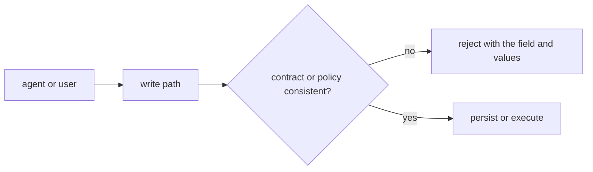
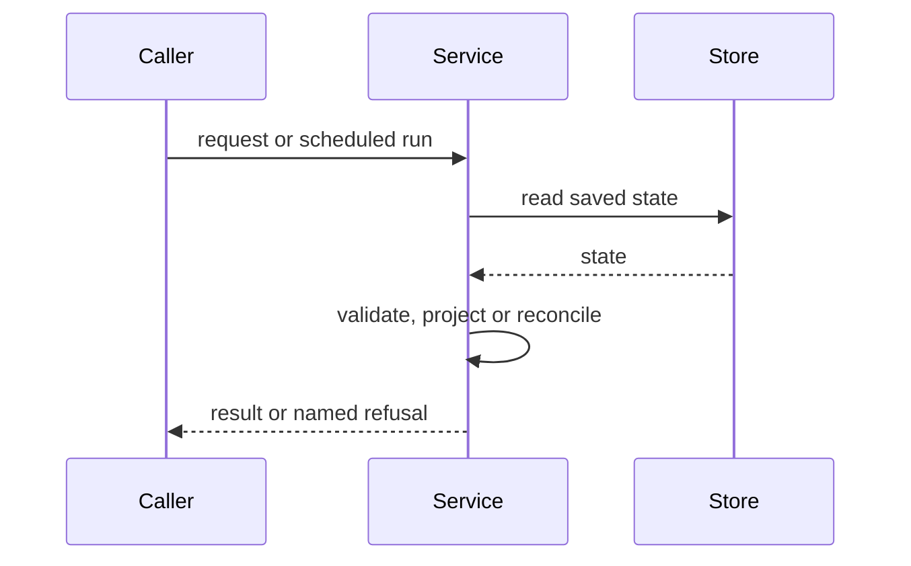

# Why

<!-- The problem, in one or two sentences, in behaviour-facing terms. -->

# What changed

-

<!-- Call out anything intentionally left unchanged, and name the commits. -->

# Visuals

<!-- Keep whichever diagram explains this change; delete the rest. Replace the placeholders. -->

<!-- Schema or migration change? Add an ER diagram. Lifecycle change? Add a stateDiagram-v2. Layout change? A before/after tree works too. -->

# Validation and proof

| Check | Command | Result |
| --- | --- | --- |
| frontend tests | `cd meu_frontend && bun run test` | |
| frontend types | `cd meu_frontend && bunx tsc --noEmit` | |
| scheduler tests | `cd meu/schedulerService && bun run test` | |
| scheduler types | `cd meu/schedulerService && bunx tsc --noEmit` | |
| notification tests | `cd meu/notificationService && bun test` | |
| manual | | |

<!-- Name the evidence: test names, counts, command output. Say plainly what was NOT verified. -->

# CLI proof

<!-- Terminal output, or before/after UI state, showing the visible result. Delete this section when the change has no observable surface. -->

| Before | After |
| --- | --- |
|  |  |

# Risk and rollback

-

<!-- What could regress, what is intentionally unchanged, and how to reverse this safely. -->

---

- [ ] `bun run test` and `bunx tsc --noEmit` pass in every touched package
- [ ] the new behaviour is covered by a test, or the PR says why not
- [ ] the new check fails without this change
- [ ] no new dependency, or the reason is stated above
- [ ] docs or migration notes updated when behaviour or a locked decision changed
- [ ] persisted data, API contracts and exit codes unchanged, or documented in the PR
- [ ] the issue's acceptance checklist is pasted below with boxes ticked
