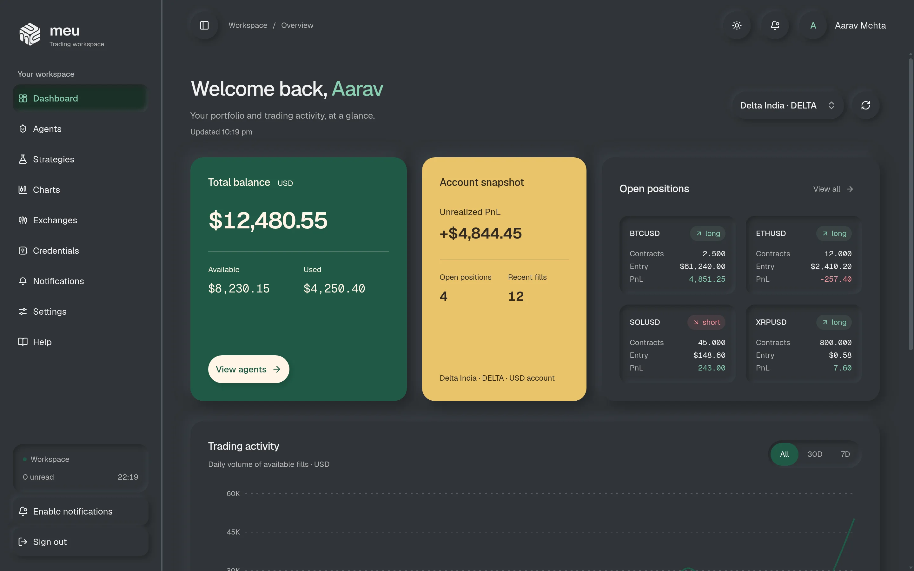
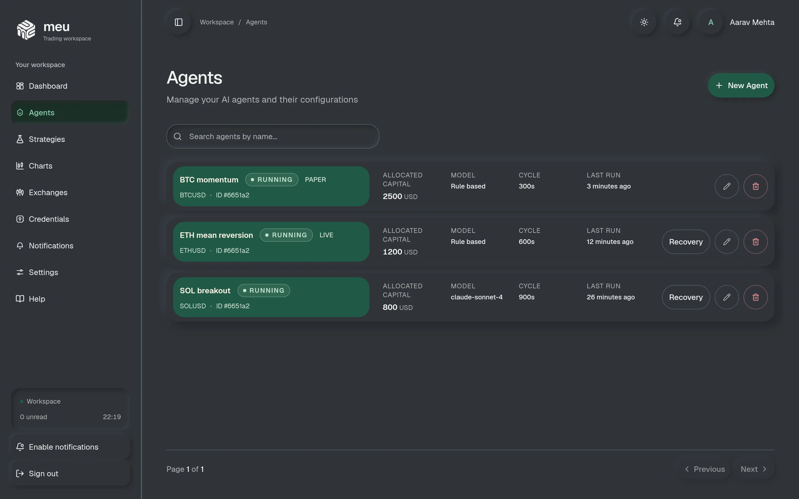
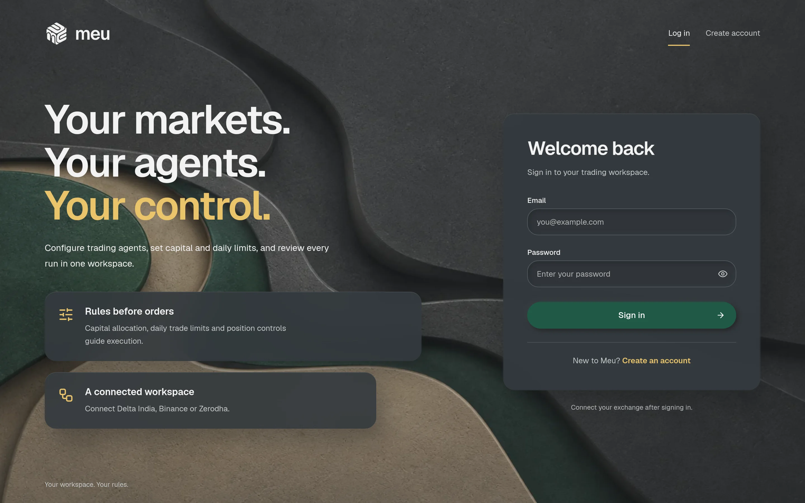
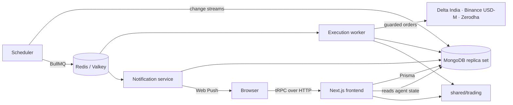

<div align="center">


# Meu

**A trading-agent workspace for markets you can explain.**

Configure agents, set capital and risk limits, and review every run — rule-based
strategies, LLM agents, historical backtests and guarded live execution in one
self-hosted app.

[](https://github.com/Goutam-11/meu-monorepo/actions/workflows/ci.yml)
[](LICENSE)
[](meu_frontend/package.json)
[](https://bun.sh)
[](https://nextjs.org)
[](https://www.typescriptlang.org)

[Documentation](docs/README.md) · [User guide](docs/USER_GUIDE.md) · [Architecture](docs/ARCHITECTURE.md) · [Development](docs/DEVELOPMENT.md)

</div>



## What is Meu?

Meu is a self-hosted trading workspace built as a monorepo: a Next.js frontend,
a scheduler, an execution worker and a notification consumer, sharing one
deterministic trading library. It connects to **Delta Exchange India** (primary
crypto integration), **Binance USD-M** and **Zerodha (Kite)** through owner-scoped
API credentials you store yourself.

It is built for the part of trading automation that is hard to trust: knowing
*why* an agent acted, what it was allowed to do, and what happened when the broker
did not answer. Every run is persisted, every order passes risk and ownership
guards, and ambiguous broker outcomes park the agent for review instead of
guessing.

> [!WARNING]
> Meu can place real orders on real exchanges. Live execution is opt-in per agent,
> strategies are not investment advice, and past simulation is not a promise of
> future results. Read [Supported capabilities](docs/USER_GUIDE.md#supported-capabilities)
> before connecting a funded account.

## Features

| Area | What you get |
|---|---|
| **Agents** | Rule-based and LLM-driven agents with per-agent capital, symbols, cycle time and risk limits. |
| **Strategies** | EMA crossover, Donchian breakout and Bollinger/RSI mean reversion, plus LLM tool-calling runs with bounded memory. |
| **Research** | Historical backtests and forward paper simulation on the same strategy contracts used live. |
| **Execution safety** | One editable risk policy per agent, account/ticker ownership, isolated-margin and leverage checks, non-expiring locks for ambiguous orders. |
| **Recovery** | Contract-drift detection, a reconciler for `REVIEW_REQUIRED` executions, and a scoped lock-recovery UI. |
| **Operations** | Structured, redacted logs; durable daily counters; in-app notifications and Web Push. |
| **Workspace** | Portfolio dashboard with a cached first paint, charts, searchable provider/model catalogs, and per-run history. |

| Agents | Sign in |
|---|---|
|  |  |

## Architecture



- **Frontend** — Next.js 16 App Router, tRPC, TanStack Query, Prisma, Better Auth.
- **Scheduler** — watches agents in MongoDB and schedules recurring runs through BullMQ.
- **Worker** — selects the strategy/provider, claims execution, enforces broker guards and persists evidence.
- **Notification service** — consumes the queue, stores a durable inbox and delivers Web Push.
- **`shared/trading`** — deterministic rules, sizing, backtests and paper execution reused by every package.

Runtime relationships, state machines and data contracts are documented in
[docs/ARCHITECTURE.md](docs/ARCHITECTURE.md) and [docs/DATA_MODEL.md](docs/DATA_MODEL.md).

## Quick start

**Requirements:** [Bun](https://bun.sh) 1.3+, a MongoDB **replica set** (transactions
and change streams are required), Redis or Valkey for the queues, and Podman or
Docker for the full stack.

```bash
git clone https://github.com/Goutam-11/meu-monorepo.git
cd meu-monorepo

# Each service keeps its own lockfile; there is no root install step.
(cd meu_frontend && bun install --frozen-lockfile)
(cd meu/schedulerService && bun install --frozen-lockfile)
(cd meu/notificationService && bun install --frozen-lockfile)
```

Copy the `.env.example` files to `.env` and fill them in — see
[container setup](docs/CONTAINERS.md). Then generate the Prisma client and start:

```bash
(cd meu_frontend && bunx prisma generate)

make check   # validate the Compose configuration
make up      # start frontend, scheduler, worker, notifications and dependencies
make logs SERVICE=worker
make down
```

`make dev` starts the development stack. The default engine is Podman; use
`ENGINE=docker` for Docker. **Startup resumes persisted RUNNING agents**, so it is
an operational action, not a build check.

### Run the frontend on its own

```bash
cd meu_frontend
bun run dev          # http://localhost:3000
```

## Testing and quality gates

```bash
(cd meu_frontend && bun run test && bunx tsc --noEmit && bun run build)
(cd meu/schedulerService && bun run test && bun run typecheck)
(cd meu/notificationService && bun run test && bun run typecheck)
```

| Suite | Coverage |
|---|---|
| Frontend | 179 tests across 25 files — forms, procedures, recovery UI, snapshot first paint |
| Scheduler | 290 tests — offline execution, sizing, ownership, cursor and recovery behaviour |
| Notifications | 8 tests — consumer idempotency, push delivery and failure handling |
| Research | 157 tests / 110,708 assertions — strategy reproduction ledgers (local evidence) |

GitHub Actions runs the three package suites, type checks and the frontend
production build on every push to `main` and every pull request — see
[ci.yml](.github/workflows/ci.yml). Research ledgers and candle caches are
deliberately local-only, so that suite is not part of CI; the evidence boundary is
described in [docs/reports/README.md](docs/reports/README.md).

Browser checks run separately from unit tests:

```bash
cd meu_frontend
bun run e2e:dashboard   # real Chromium: snapshot first paint, failed refresh, hidden-tab polling
bun run screenshots     # regenerate docs/images/*.webp from the running app
```

Both scripts need the app on `http://localhost:3000` and a seeded local database;
[meu_frontend/scripts/e2e/README.md](meu_frontend/scripts/e2e/README.md) has the
full setup and the measured numbers.

## Repository layout

| Path | Responsibility |
|---|---|
| `meu_frontend/` | Next.js UI, authenticated APIs, Prisma schema and frontend tests |
| `meu/schedulerService/` | Scheduler, execution worker, risk checks and service tests |
| `meu/notificationService/` | Notification persistence and Web Push consumer |
| `shared/trading/` | Strategy, sizing, backtest and paper-execution contracts |
| `docs/` | Architecture, capability, data and maintenance documentation |
| `scripts/` | Repository tooling and local research commands (artifacts stay local) |
| `report/` | College report built separately; not tracked (see [repository policy](docs/REPOSITORY.md)) |

## Documentation

- [Documentation index](docs/README.md) — start here.
- [User guide and capability matrix](docs/USER_GUIDE.md) — what each market supports.
- [Architecture](docs/ARCHITECTURE.md) · [data model](docs/DATA_MODEL.md) · [module map](docs/MODULES.md).
- [Development and maintenance](docs/DEVELOPMENT.md) — change checklist and gates.
- [Containers](docs/CONTAINERS.md) · [logging](docs/LOGGING.md) · [recovery](docs/DELTA_RECOVERY.md) · [reconciliation](docs/RECONCILIATION.md).
- [Research evidence boundary](docs/reports/README.md) — what a re-run can and cannot reproduce.

## Security

- Credentials are encrypted at rest with `ENCRYPTION_KEY` and scoped to their owner.
- `.env` files are git-ignored; use environment overrides and never commit secrets.
- Tests use fixtures, fakes and intercepted responses — no workflow places a live order.
- Logs are redacted; report a suspected vulnerability privately to the maintainer
  rather than opening a public issue.

## Contributing

This is a personal project, but pull requests are welcome. Keep one concern per
branch, follow [the PR template](.github/PULL_REQUEST_TEMPLATE.md), add a test for
new behaviour, and run the gates above. Behaviour that affects saved agents,
persisted data or broker calls needs a note in the PR body.

## License

Released under the [MIT License](LICENSE). © 2026 Goutam Kumar Sharma.
