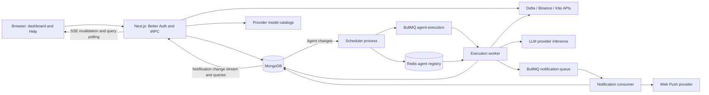
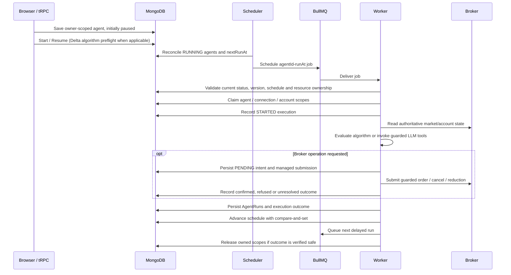
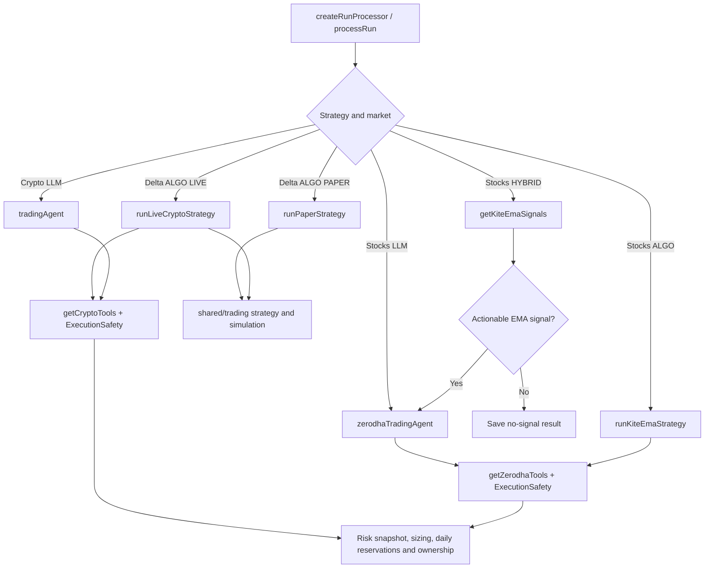
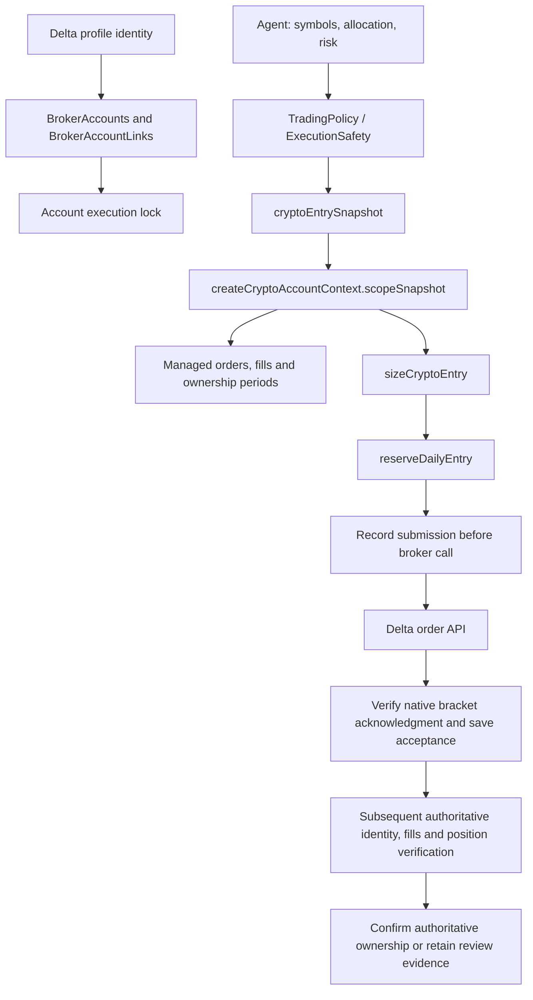
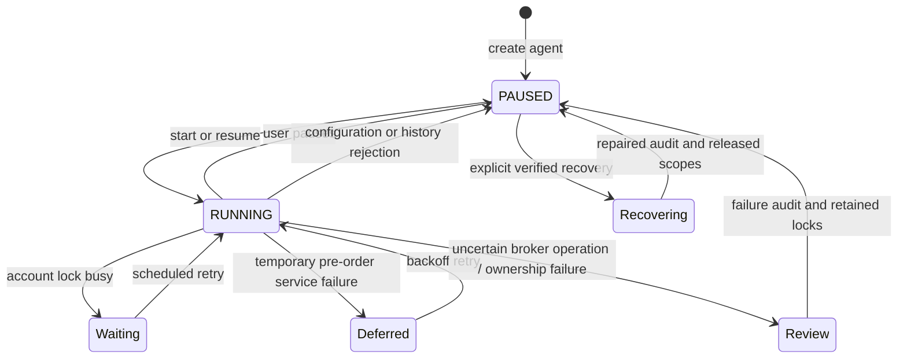

# Architecture

Reviewed against source on 8 October 2026. [Documentation index](README.md) · [module map](MODULES.md) · [persistence](DATA_MODEL.md).

## Process boundaries

The frontend is also a server: account preflight, broker reads, historical data loading and recovery run there. `shared/trading` is imported source, not a separate service. The two service processes under schedulerService use the same code/dependencies but run independently. Exchange background synchronization modules are not started by `index.ts`; account dashboards query their providers directly.

Mongo is the durable source of truth for status, schedules, executions, ownership and configuration. Redis holds a non-secret registry and BullMQ jobs. The registry is refreshed from Mongo; it is not the authority for broker positions or user ownership. Credentials are fetched and decrypted server-side, not cached in the agent registry.

## One scheduled execution

The worker rejects stale status/schedule versions before executing. `nextRunAt` stays on the pending/active run until a worker or reconciliation step advances it. Job IDs and durable execution IDs prevent replay from being treated as a new order. A broker acknowledgment is not a fill; fills/positions are verified separately.

## Execution dispatch

Crypto HYBRID is rejected rather than silently routed to an LLM. The frontend/server configuration gates decide which paths are offered. The shared Delta simulation does not establish identical live fill behavior; Kite EMA uses its own broker execution adapter.

## Delta ownership and safety boundaries

Delta accounts are identified by verified profile identity, not by the label assigned to a saved key. Duplicate saved connections share an account lock and account-wide risk caps. Different tickers can run concurrently as agents; account operations execute serially. A single live owner controls a product/ticker. Manual exposure is not adopted automatically.

## Pause, failure and recovery

`Waiting`, `Deferred`, `Review` and `Recovering` are explanatory execution conditions, not extra values of `Agent.status`; persisted agent status is RUNNING or PAUSED. Pausing prevents future authorized operations; it does not immediately cancel an already active request, close a position or delete locks.

An intentional live algorithm Resume stamps a new activation and warms indicators from fresh completed candles without executing paused-period signals. A process restart does not invent an activation. Temporary known pre-order failures retry/release safely. Typed history/guard rejections before operations release scopes after their audit is confirmed; uncertain outcomes retain them.

Recovery performs fresh broker reads, checks paused peers and queue inactivity, validates exact managed identities/terminal states and requires a flat account without pending orders. It records repairs and releases only the failed execution's scopes, connection last. See [the recovery runbook](DELTA_RECOVERY.md) for supported cases, interrupted steps and the remaining crashed-coordinator limitation.

## Notification delivery

Events are emitted through `lib/notifications.ts`; the consumer persists notifications idempotently by delivery job ID before attempting Web Push. The Node.js frontend instrumentation watches Mongo Notification changes and emits SSE invalidations, including separate-consumer inserts. Frontend mutations also emit local invalidations; 60-second query polling and focus refetch cover missed stream events. Provider acceptance of a push is not proof a user saw a popup. Notifications and execution audits serve different retention/recovery purposes; see [logging](LOGGING.md) and [data model](DATA_MODEL.md).
