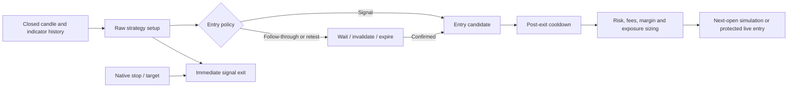
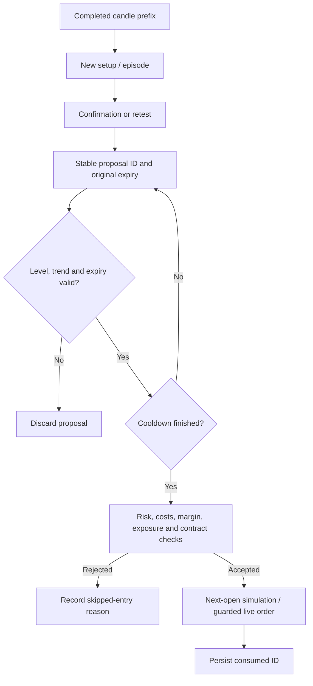

# Strategies and Delta India execution

## Historical research

The authenticated `/strategies` workspace runs EMA crossover, Donchian breakout and Bollinger/RSI mean reversion against public Delta India candles. Saved runs are scoped to their owner and retain the input, strategy version, contract snapshot, candles, SHA-256 data hash, warnings and results. Historical research needs no exchange API key and does not create or schedule an agent.

In **Agents → New Agent**, select **Rule Based Algorithm** with **Crypto**. Name, exchange, ticker, polling cycle, capital and risk remain in the agent form. Choose EMA crossover, Donchian breakout or Bollinger + RSI, plus candle timeframe, ATR brackets, isolated leverage, margin budget and paper/live mode. **Create agent, paused** creates directly without requiring a saved backtest. Contract metadata and complete indicator history are resolved from the trusted Delta India API on the server; client-supplied contract or activation fields are ignored. **Backtest these settings · last 30 days** is optional and opens the saved result in Strategies, retaining the chosen parameters. Crypto hybrid execution remains unimplemented.

Stock algorithm creation uses the same common sections but currently runs only EMA through Zerodha, with multiple symbols and the legacy entry-notional cap. Crypto algorithms support one perpetual ticker, one open position and USD wallet units; their trade-risk limit measures estimated loss at the stop plus buffered costs. Polling interval is separate from candle timeframe and cannot exceed it. Create routes start all new agents paused. Paused algorithm agents have a dedicated editor. Ticker, connection and execution mode remain fixed; execution changes use verified state revisions as described in [paper/live editing](PAPER_TRADING.md#editing-and-retained-portfolios).

Signals use completed candle prefixes. Entries and signal exits execute no earlier than the following candle open. One position is allowed, without pyramiding. Sizing, fees, constant assumed funding, isolated-margin liquidation and intrabar stop/target ordering are simulated approximations; see the run warnings and the saved snapshot. In particular, historical funding is not used, partial fills, spread, taxes and latency are omitted, and liquidation uses trade-price OHLC rather than exchange mark prices and margin tiers. New Delta simulations and forward guards reset at India midnight (Asia/Kolkata); old saved backtests retain their original UTC results. Generic offline simulations default to UTC. Backtests and paper state retain at most 10,000 indicator candles. The run history is limited to 100 per owner.

Research and validation labels are user-selected. The application does not prevent overlapping periods or parameter selection on validation data and does not certify profitability.

## Forward paper and live agents

Create a paused Delta India crypto algorithm directly from New Agent or from an owned, supported saved-run snapshot in Strategies. Strategy parameters and contract terms are saved snapshots; supported paused edits revalidate metadata and create a new state revision when execution settings change. The new agent starts paused and does not place orders until started. Starting stamps `strategyStartedAt`: older signals remain inactive, so activation does not enter from a signal formed before the agent was started. If the optional timestamp is absent on an older record, the scheduler uses the current time as its activation boundary.

Paper mode advances the same deterministic strategy over fresh public Delta candles with simulated USD funds. It does not decrypt or use exchange credentials and does not call private broker endpoints or place real orders. The paper portfolio initializes on its first scheduler run, warms indicators, and waits for a fresh completed candle. It models fees, the configured constant funding assumption, stops, targets and approximate liquidation; these remain simulations, not exchange fills. It stores up to 10,000 indicator candles and only the latest 200 completed trades (lifetime trade counters remain cumulative). A cap or candle/contract inconsistency requires review or reset.

While a paper agent is paused, scheduled execution stops. On resume, the simulator can replay protective exits over candles missed during the pause, while suppressing new entries from those candles. Paper daily counters use India midnight. Paper state is available only to its owner.

Live mode can place real Delta India orders after clicking Start Agent in the agent detail view. It requires saved Delta credentials, production market data, isolated leverage matching the snapshot and a flat strategy symbol with no pending orders on its first start. The automatic Start flow applies and verifies saved leverage when safe. Different tickers may run together. Account-wide margin-mode changes require other live agents to be paused and a completely flat account, and leverage changes require a flat ticker. Unknown or unverified settings keep the agent paused. Saved Delta algorithm entries use native exchange stop/target brackets and separate limits for estimated loss at the rounded stop, buffered margin and leveraged notional exposure. Legacy LLM/Binance agents retain full-notional guards; explicitly configured native-stop policies use their supported protected adapters. Their sizes, fills and outcomes can differ from the ATR-based simulator: exchange-side brackets govern protection, while the backtest and paper engine approximate execution on candle OHLC.

Live execution verifies stored order ownership against the agent, verifies position size and side against its filled entry, and blocks foreign pending entries or unowned positions. Partial entry fills, uncertain broker operations, missing candles/backlogs, changed contract terms, or failed cursor persistence pause the strategy for reconciliation instead of guessing or replaying stale signals. An intentional pause/resume starts a fresh activation boundary and warms indicator history without replaying stale entries. A gap during the same live activation still requires review; a worker restart does not erase it. A different running live agent covering the same canonical symbol on the same exchange blocks activation/execution; keep a single live owner per symbol.

Pausing a live agent stops future scheduler runs. It does not close an open exchange position or cancel pending exchange orders; native protective brackets remain active. Review the exchange account and reconcile outstanding orders/positions before resuming when the agent requests review.

## Persistence and limits

`BacktestRun` is Prisma-managed and owner-scoped. Forward paper and live cursor state is kept in raw MongoDB collections (`PaperTradingState` and the live strategy state collection), keyed by string agent IDs and paired with the owner ID. The existing `Agent.executionMode` and `Agent.strategyStartedAt` fields are nullable for older agents. The run creation route uses owned saved runs and owned Delta exchanges; live mode also checks that credentials are saved. Paper state reads remove indicator history from the response and return derived equity and history count.

The scheduler uses per-agent execution claims for paper and per-agent, per-connection and verified physical-account locks for live trading. Uncertain live operations keep locks until explicit reconciliation. Saved strategies require production Delta India public market data; sandbox exchange entries are rejected.

## Schema and verification boundaries

The Prisma schema includes the saved-run model and its owner/time index. Deploy schema changes through the normal reviewed schema process. This documentation describes the implementation; no database migration or live-order operation is performed by documenting it. Tests use offline fixtures and fake persistence rather than private broker accounts or live orders.

Browser surfaces were unavailable during documentation, so the behavior and design notes are verified from source only. No browser interaction or visual verification is claimed here.

## Sizing and automatic leverage

See [sizing policies](SIZING_POLICIES.md) for shared risk/margin/exposure calculations, fixed versus automatic algorithm leverage, 100% margin, gross-notional percentages and compatibility with saved configurations. Paper/backtest AUTO uses the saved sizing objective (legacy absence keeps first-tradable leverage) within the ceiling; live execution additionally verifies flat-ticker broker settings and durable setting intents.

## Entry timing and simpler setup (strategy engine 1.1.0)

New Delta crypto algorithms and backtests default to **Wait for follow-through**: one later completed candle must hold the original setup level and close farther in the signal direction. EMA also requires its fast/slow trend to remain intact. The original level is the slow EMA at the crossover, the prior Donchian channel boundary, or the Bollinger band at the re-entry setup. This is a confirmation policy, not a profitability claim.

**Wait for a retest** requires a later candle to touch that level and close on the desired side. Setups expire after three candles by default. A retest can miss a strong trend that never pulls back. **Enter on signal** retains immediate setup handling. Advanced controls accept 1–5 confirmation closes, a 1–20 candle waiting window (at least the confirmation count), and 0–20 cooldown candles.

After an actual exit, new configurations rest for two completed candles before entering again. Stop, target, liquidation and raw opposite/mean-return exits are never delayed by entry confirmation or cooldown. Live cooldown begins when the broker exit is observed, so it can be more conservative than the simulator. Paper state persists pending exits and the cooldown cursor; live state persists the observed exit candle. Resume ignores setups formed before the new activation boundary.

`StrategyConfig.entryTiming` is optional. Its absence preserves legacy entry and reversal behavior; new UI defaults do not rewrite existing saved agents or research snapshots. Explicit zero cooldown still prevents simulator entry during the same candle as an exit. The stock EMA/Hybrid execution path does not use this crypto strategy configuration.

The backtest basic form asks for algorithm, ticker, timeframe, dates, capital, risk at stop and entry style. It supplies EMA 20/50, channel/band 20, ATR 14, stop 2× ATR, reward/risk 1.5, automatic leverage up to 3×, margin at most 25%, exposure at most 2× allocation, and a daily-loss ceiling of three times selected risk (capped at 100%). Entry quantities remain calculated from the stop plus costs and contract bounds. Advanced settings retain all controls. An explicit Automatic/manual daily-loss choice owns the effective value; merely opening or closing Advanced never changes it. Advanced settings are editable assumptions, not exchange guarantees.

A price-chart query reads only the owner's saved snapshot and is bounded to 10,000 candles. Entries/exits are tied to saved trade timestamps; selected-trade analysis reconstructs indicators from the saved config. Price-chart overlays explain strategy behavior; the equity chart includes costs. Indicator reconstruction must be identified as such for older snapshots rather than presented as a recorded live rationale. Compare fees and net outcomes on equivalent periods, then validate on unseen data instead of optimizing a single month.

## Configuration foundations (10 October 2026)

New backtests use shared fee/slippage planning defaults of 10/5 bps per side and explicitly save `simulation.autoSizing: "TARGET_RISK"` in automatic leverage mode. This funds the largest bounded rounded size and then selects its lowest sufficient leverage. Advanced can select the first tradable leverage instead. Fixed mode omits the automatic objective. Existing saved runs remain immutable and missing fields keep their original calculation.

The daily-loss setting has an explicit automatic/manual choice. Automatic derives three times selected risk, capped at 100%; manual preserves the entered value regardless of disclosure visibility. These assumptions are saved with the run. They do not establish that a strategy is profitable or recreate historical broker tiers, funding rates or order-book fills.

## Experimental execution rules v1

Version 1 remains an internal research and saved-run compatibility policy. Normal forms no longer expose a signal-policy selector; new configurations use original rules. The optional saved field is `strategy.executionRules: {version: 1}`. Absence preserves existing signals, fills and accounting. Editing an existing algorithm preserves its saved policy. Stock algorithms and LLM agents do not consume this policy.

The optional policy changes these behaviors:

- A confirmed proposal keeps its original expiry and level while waiting for cooldown. Confirmation does not extend expiry. Each proposal is consumed only by an accepted simulation entry or submitted live order; a cancellation does not authorize replay of the same setup.
- EMA can form a fresh completed-candle fast-EMA pullback/reclaim in an existing trend. It requires directional slow-EMA slope, fast/slow separation of at least 0.1 ATR and extension from fast EMA of at most 1.5 ATR. These mechanical thresholds are not optimized or validated performance guarantees.
- Donchian identifies distinct breakout episodes. Continued closes beyond the original boundary cannot continually rearm entries; a close back through that boundary resets the episode.
- Bollinger/RSI checks the range before the excursion/reclaim pair: slow-EMA drift over five bars and fast/slow separation must each be at most 0.5 ATR on the prefix ending two bars before the setup. Native targets use the completed-candle mean. Estimated reward after round-trip costs must cover at least 0.75 times stop distance and twice those costs. A favorable mean crossing closes only the applicable position side.
- Enhanced FIXED and AUTO simulations share rounded size/budget checks and liquidation-distance rejection. Gross daily loss includes fees, negative funding and losing realized price P&L; gains do not replenish it. Both enhanced and legacy Delta paper simulations reset this allowance at India midnight, matching new Delta backtests. Live account guards use the same India-day boundary with independent authoritative broker checks.

Backtest results include counts for candidate evaluations, accepted entries and skip reasons. Counts are evaluations, not distinct opportunities. Recorded enhanced trade protection levels take precedence over ATR reconstruction in chart analysis. Live execution verifies proposal expiry and current quote against the original boundary before settings/order changes, rechecks the sizing quote, and persists accepted proposal IDs. Native exchange protection remains authoritative; simulation does not reproduce order-book fills.

### Replay evidence and limitations

The three previously audited BTCUSD 1h September–October snapshots reproduced their legacy final equity exactly after these changes. On those same already-seen candles, opt-in results were:

| Strategy | Legacy return / trades | Experimental return / trades | Experimental drawdown |
|---|---:|---:|---:|
| EMA | +1.33% / 9 | -5.37% / 15 | 5.90% |
| Donchian | -1.78% / 17 | -0.72% / 13 | 3.56% |
| Bollinger + RSI | -2.35% / 13 | 0% / 0 | 0% |

The EMA pullback variant worsened performance and trade frequency. Donchian fees fell but drawdown increased. The mean-reversion economics/range filters found no eligible trades. Therefore the policy remains off by default and should be compared on unseen periods in paper mode before live use. No saved agent allocation or status was changed by this implementation. See implementation replay (local evidence, excluded from Git).

## Trend-aware signal policy v2

Version 2 is retained for offline research and reproduction of saved runs. Its EMA entry modes are crossover, established trend, or combined. These implementation choices are no longer exposed in ordinary forms. New configurations use original rules; editing preserves the existing saved policy. Use the offline comparison script and retained evidence to inspect version differences; existing configurations are not upgraded automatically.

V2 separates the fast/slow crossover event from eligibility of an established trend. It uses signed ten-close efficiency: net movement divided by the sum of absolute close-to-close movements. In the candidate direction this must be at least 0.35. Established EMA entries also require five-bar slow-EMA movement of at least 0.25 ATR, fast/slow separation of at least 0.25 ATR, price on the trend side of the fast EMA and extension at most 1.5 ATR. These are research thresholds fixed in source, not exchange rules or optimized return estimates.

A newly eligible established trend can create a fresh setup after an old crossover expired. Once a proposal confirms, ordinary pullbacks cannot continually create more entries in that phase. Opposite fast/slow alignment resets the phase; three consecutive closes with signed directional efficiency at or below 0.2 also reset it. This is not a permanent ban on re-entry. Resume can create a fresh setup from a newly completed qualified candle after activation; it never executes a paused-period setup.

Crossover entries use directional efficiency and extension checks without requiring mature EMA slope/separation, because a new crossover has not yet developed that separation. Donchian uses directional efficiency without demanding lagging EMA alignment; it retains v1's distinct breakout episode and expiry rules. Mean reversion remains v1's range/economic policy. The shared sizing, daily-loss, native-protection and reconciliation limits still apply.

EMA proposals carry their actual source and a causal extension price bound from the latest completed candle. Historical fills (including slippage), paper fills and live quotes are checked against that bound. A gap beyond it is skipped rather than chased. The chart identifies established-trend entries correctly and shows reasons such as weak directional efficiency, insufficient trend strength, price extension or an already confirmed phase.

See full signal comparison (local evidence, excluded from Git). V2 is a research option: it reduces repeated/noisy entries but does not establish profitability or capture every visible move. Targets remain fixed; no unverified live trailing-stop updates were added.

## Adaptive exit internals

See [exit management](EXIT_MANAGEMENT.md) for the shared opt-in ATR trailing engine, paper restart validation, recorded chart protection changes and comparison results. Fixed protection remains the default; live adaptive amendments are not enabled.

See daily-boundary migration and matched replay (local evidence, excluded from Git) for the 11 October correction and retained UTC research convention.
