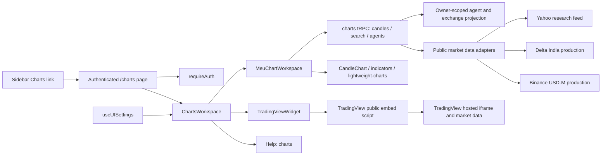

# Meu charts and TradingView

The authenticated `/charts` route defaults to **Meu charts**, rendered with the free `lightweight-charts` package. Authenticated tRPC endpoints fetch public Yahoo, Delta India and Binance USD-M candles. **TradingView** remains an optional hosted widget view. No database changes or broker credentials are required for chart data.

## Use

- Select Yahoo for stocks/indices, Delta India for USD perpetuals or Binance USD-M for USDT perpetuals. Yahoo shortcuts include Nifty 50 (`^NSEI`), Nifty Bank (`^NSEBANK`) and Sensex (`^BSESN`); NSE equities use `.NS` and BSE equities `.BO`.
- Search the provider catalog or enter a known ticker. Public crypto catalogs are filtered to live supported perpetuals. Search returns at most 30 matches (20 Yahoo candidates). Delta catalog discovery is bounded to 500 perpetuals and explicitly errors if more pages are required rather than silently presenting an incomplete list.
- Open a production agent ticker in the selector, or use **View chart** on agent details (`/charts?agent=<id>`). Owned agent/exchange records are projected to non-secret metadata only. Delta CCXT aliases map to native `BTCUSD`-style tickers; Binance maps to `BTCUSDT`; Zerodha equity tickers map to Yahoo `.NS` equivalents. Unsupported and sandbox connections are excluded. No orders are sent.
- Choose 5m, 15m, 1h or 1d; up to 750 valid candles are displayed. Yahoo requests bounded 5d/1mo/3mo/2y ranges respectively, so returned bar counts can be smaller. The latest candle can be forming.
- Pan/zoom, fit history, inspect crosshair OHLCV and toggle EMA 20/50 or Bollinger 20/2. Volume and Wilder RSI 14 have separate panes. RSI flat history returns 50; EMA seeds from a simple average and Bollinger uses population standard deviation. These research indicators do not claim parity with every saved strategy.
- Auto refresh is 60 seconds for Yahoo and 30 seconds for crypto while active. Refresh failures keep existing history visible with an explicit stale/error message. Changing symbol/interval does not retain the prior market’s candles. Ordinary refreshes preserve the visible chart range; theme or market changes reset it.
- Charts use Meu’s Graphite/Pearl theme. Timestamps and crosshair labels use IST. Fetch time, last candle start and available Yahoo provider quote time remain separate; refreshing a feed does not make an old candle current. An age warning is heuristic, not an exchange-calendar check.
- The optional TradingView widget retains drawings/indicator tools and crypto/global market overview. NSE shortcuts were removed from embeds because NSE is not listed in their supported widget data. Meu native chart drawings, live positions, fills and stop/target overlays are not implemented.

## Data and cost limits

[Lightweight Charts](https://www.tradingview.com/lightweight-charts/) is free/open source; its attribution/logo remains visible. It supplies rendering, not market data. Yahoo is an unofficial research feed and may be delayed, rate limited or changed. Meu charts do not require Zerodha's paid data plan; the [free Personal API excludes live/historical data](https://support.zerodha.com/category/trading-and-markets/general-kite/kite-api/articles/what-are-the-charges-for-kite-apis). Free access does not establish data redistribution rights for a public/commercial deployment.

[TradingView widgets](https://www.tradingview.com/widget/) are also free with branding, but [data licensing restrictions](https://www.tradingview.com/widget-docs/faq/data/) remain. An iframe load is not proof of fresh data. Binance USDT perpetuals, Delta India USD perpetuals and Yahoo index/equity references are distinct. No currency conversion is performed; charts do not substitute for broker execution evidence.

## Modules and dependencies

- `meu_frontend/src/app/(dashboard)/charts/page.tsx`: server-side authentication boundary.
- `meu_frontend/src/features/charts/components/charts-workspace.tsx`: provider tabs and optional embed lifecycle; `meu-chart-workspace.tsx` owns native chart selection/fetch UI; `candle-chart.tsx` owns renderer lifecycle and refresh updates; `indicators.ts` contains local indicator calculations; `types.ts` contains source metadata and ticker mapping.
- `server/router.ts`: protected procedures, owner-scoped agent metadata, 20-second public candle cache, 60-second search cache, deduplicated requests, maximum eight concurrent unique requests and 128 cached entries. Private agent context is not cached or sent to data providers.
- `server/data.ts`: allowlisted provider origins and validated symbols, no redirected fetches, 12-second request timeout and 2 MiB response limit. Candles are checked for finite positive OHLC, valid ranges, nonnegative volume and future timestamps; invalid bars are skipped, duplicates collapsed and results sorted/capped. Empty results error; no sample candles are fabricated. Crypto catalog caches last five minutes. Errors return sanitized provider names/status and retry guidance; tRPC logs identify chart procedures without logging secrets or full payloads.
- Only the selected tab mounts a widget. Each effect owns its container; cleanup removes it, disconnects the observer and removes listeners/timers. Keyed theme/symbol changes isolate stale callbacks.
- Script errors or a missing iframe load after 25 seconds show a retry action; the iframe remains available if it arrives late. Cross-origin market/data errors stay within TradingView’s UI.
- No API keys, agent settings or account balances are sent to TradingView. Loading the embed still makes ordinary browser requests to that third party.

## Verification

`meu_frontend/tests/charts.test.ts` covers provider payload normalization, timestamp units, invalid candles/symbols, sanitized errors, catalog filtering, ticker mapping and indicator numerical behavior. Read-only runtime checks returned Yahoo Nifty and Delta/Binance BTC candles and search results. Typecheck, lint and production build cover the integration boundary. Browser checks should cover desktop/mobile, themes, agent selection, intervals, indicators, zoom preservation and retry states. No browser surface was available during implementation; server checks alone cannot verify visual rendering.

Official integration reference: [Advanced Chart widget](https://www.tradingview.com/widget-docs/widgets/charts/advanced-chart/), [Market Overview widget](https://www.tradingview.com/widget-docs/widgets/watchlists/market-overview/).
