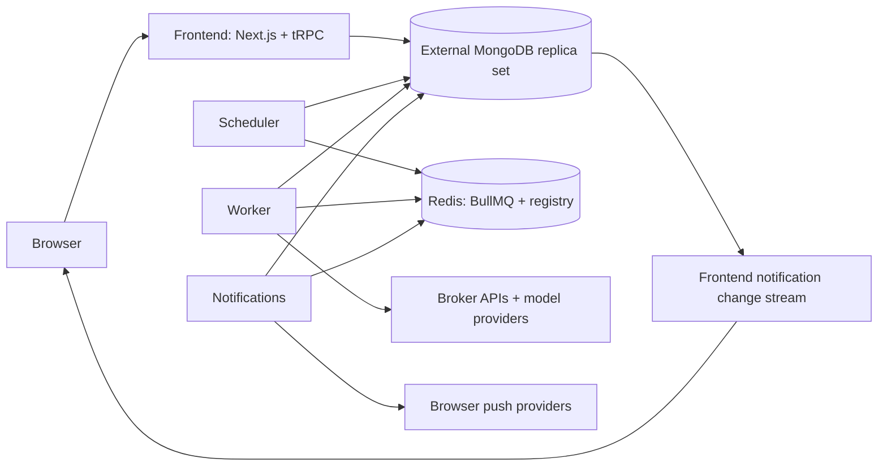

# Run the complete Meu stack

Run commands from the monorepo root. The stack contains frontend, scheduler,
one worker, notifications and Redis. MongoDB remains your existing external
replica-set connection. No database migration, encryption migration or agent
activation is performed by container startup.

## Setup

1. Install Docker with Compose, or Podman with a Compose provider.
2. Configure the existing service files: `meu_frontend/.env`,
   `meu/schedulerService/.env`, `meu/notificationService/.env`.
3. Copy the root `.env.example` to `.env`. Reuse the existing 64-character hex
   `ENCRYPTION_KEY` used for stored encrypted records. Do not generate a replacement
   for an existing deployment. Root Compose overrides both frontend and worker
   keys with this one shared value. Back up it securely along with the database.
4. Set root `NEXT_PUBLIC_APP_URL` and public VAPID key to match the frontend values.
   These are compiled into the production frontend. Keep `BETTER_AUTH_URL`, OAuth
   callbacks, provider endpoint overrides and private VAPID configuration aligned
   in the service env files. All services must point to the same Mongo database.
5. Stop any host frontend using port 3000 and any host scheduler/workers using
   the same account/database before switching to containers. Do not run the old
   scheduler Compose stack alongside this one.

The current machine's root `.env` was initialized from the existing frontend
values, preserving its encryption key. Secret env files are excluded from Git
and build contexts. They are supplied only at runtime. Next builds use a dummy
database URL and build-only authentication secret; they do not contact Mongo or
start trading workers.

## Commands

```sh
make check                     # validate Compose syntax; never prints resolved secrets
make up                        # build and start all services in production mode
make ps
make logs
make restart                   # graceful restart, keeping data
make down                      # remove containers/network, keeping named volumes
make dev                       # development frontend + source mounts for services
```

The Makefile defaults to Podman. Docker users add `ENGINE=docker`:

```sh
make up ENGINE=docker
```

Equivalent direct commands:

```sh
podman compose -f compose.yaml -f compose.podman.yaml up -d --build
podman compose -f compose.yaml -f compose.podman.yaml -f compose.dev.yaml up -d --build
podman compose -f compose.yaml -f compose.podman.yaml down
# Docker: use -f compose.yaml without compose.podman.yaml.
```

Frontend: `http://localhost:3000`. It binds to host loopback by default. For
hosting behind a reverse proxy or on another interface, configure
`FRONTEND_BIND`/`FRONTEND_PORT` in the root env, and align public/auth URLs.
Redis has no published host port. There is no local Mongo container to avoid
silently replacing the database used by existing agents. A Mongo server on the
host cannot be reached from a container using `localhost`; use a reachable host
address or the existing remote replica set.

## Development behavior

`compose.dev.yaml` runs the frontend dev server with hot reload and mounts source
directories read-only. Its `.next` cache is a separate named volume. The development
frontend honors `HOSTNAME` and `PORT`, including Podman’s loopback binding and
custom host port. Scheduler,
worker and notifications continue running normal Bun entrypoints: their sources
are mounted, but they are deliberately not auto-restarted when edited during a
broker operation. Development mode does not change an agent's Paper/Live
configuration. Existing live `RUNNING` agents can trade when the development
worker starts. Restart services explicitly after a source change:

```sh
podman compose -f compose.yaml -f compose.podman.yaml -f compose.dev.yaml restart scheduler worker notifications
```

Dependency, Prisma, config or Dockerfile changes require rebuilding. The host
frontend generated Prisma client must exist for the mounted `src` directory;
run `bunx prisma generate` from `meu_frontend` after schema changes. Production
images generate their own client and never automatically run `db push`.

## State and restart behavior

Mongo stores agent status, next-run pointer, trading strategy state, run history,
daily counters, execution claims, order intents and account locks. Redis stores
the queue and cached registry in the `meu_redis-data` volume, with append-only
persistence (`appendfsync everysec`) and no eviction of queue keys. Normal
`down`, `up` and `restart` preserve this volume. Do not use `down -v` or delete
the volume as a routine restart. Redis every-second persistence can still lose
the most recent second on an abrupt machine failure; Mongo claims/locks are the
execution safety boundary.

- `PAUSED` agents stay paused. Startup does not activate them.
- `RUNNING` agents are recovered from Mongo and resume scheduling. An overdue
  pointer queues one current run, not a replay of every missed interval.
- Existing pending/active jobs keep their pointer. Completed/failed queue jobs
  advance it; they are not replayed as fresh trading executions.
- If Redis is empty, the scheduler reconstructs running schedules from Mongo.
- If the worker dies after claiming a run, persistent claims and locks prevent
  replay/takeover. An abandoned or unresolved lock triggers pause for review.
  Locks are not deleted automatically during startup. Reconcile against broker
  positions/orders before resuming a blocked agent.
- No partial LLM conversation is resumed. A safe subsequent run uses fresh
  broker data and the compatible decision memories from completed runs.

Do not blanket-pause agents on every deployment or restart. That also removes
their automated position monitoring. Pausing an agent does not close its open
positions. Exchange-native protective orders remain at the exchange during
application downtime, but an application outage and stop orders cannot guarantee
a loss limit. Use manual pause for an intentional maintenance window or when
broker state needs review.

Containers get six minutes to finish work on SIGTERM before the engine can
force-kill them. An indefinitely stalled provider call can exceed that window;
the unresolved Mongo lock then remains for review. Redis startup is gated by a
health check. Frontend `/api/health` is HTTP readiness only, not proof of Mongo,
broker connectivity or successful agent execution. Inspect `make logs`, agent
last-run timestamps and reconciliation status after restarts. Log files rotate
at 10 MiB with three retained files per container. Health failures alone do not
automatically restart containers; `unless-stopped` restarts exited processes.

For host reboots, configure the container engine's startup mechanism. Docker's
daemon must start at boot. Rootless Podman requires its user restart service
and a persistent user session (for example, user lingering). Compose alone is
not an operating-system boot service.

## Scale and verification

Start with one worker. Scale workers explicitly if needed; never replicate the
scheduler for throughput. Existing broker-account locks serialize conflicting
work across workers.

```sh
podman compose -f compose.yaml -f compose.podman.yaml up -d --scale worker=2
```

The standalone frontend includes files traced from the monorepo, shared trading
code, public assets and static assets. Bun versions are pinned. Runtime application
processes use the image's non-root `bun` user. No secrets are passed as build args.
The production and development Compose definitions were validated with Podman;
container image builds are verified separately from activating the real stack.
All four application images built successfully. Production and development
frontend images passed network-isolated HTTP checks, and the notification module
loaded without starting its consumer. The host scheduler suite passed 112 tests;
worker/recovery/memory tests were also exercised in the non-root worker image.
The full cross-service suite belongs on the host: its notification integration
probe intentionally needs the separate notification source and dependencies that
are not bundled into the worker image. These checks do not certify an actual
broker-connected deployment. These are historical build checks, not a statement of the current running stack.
Use `make ps` and authenticated application reads to check current health.

For a live Delta algorithm paused after missed closed candles, see
[Delta recovery](DELTA_RECOVERY.md). Resume can recover a proven pre-order
failure on a flat account; ordinary restarts do not clear uncertain execution
locks or activate paused agents.

### Rootless Podman outbound networking

`make` automatically includes `compose.podman.yaml` when `ENGINE=podman`.
The frontend, scheduler, worker and notification consumer use Linux host
networking to avoid observed bridge/pasta failures reaching MongoDB Atlas
primary nodes and Mozilla push. They share a Redis Unix socket; Redis has no
published TCP port. The frontend binds directly to `FRONTEND_BIND` (default
`127.0.0.1`) and `FRONTEND_PORT` (default `3000`); host networking ignores the
base Compose port mapping. The other services do not start HTTP listeners.
The private queue volume and agent/execution state are preserved.

For direct Podman commands include both files: `podman compose -f compose.yaml -f compose.podman.yaml up -d --build`. Docker uses the base Compose network as before (`make ENGINE=docker up`).

## Service dependencies



The frontend also performs authorized broker reads, start preflight and recovery.
Mongo is the durable application state; Redis is scheduling/queue transport.
Compose `depends_on` checks Redis readiness only. It does not certify a reachable
Mongo primary, broker account or provider model.

## Reading logs

```sh
make logs SERVICE=worker TAIL=200 SINCE=30m
make logs SERVICE="scheduler worker" FOLLOW=0 TAIL=100
make logs SERVICE=notifications SINCE=1h FOLLOW=0
```

`Ctrl+C` exits a following log stream without stopping containers. See
[Logging](LOGGING.md) for correlation IDs, events and safe troubleshooting.
