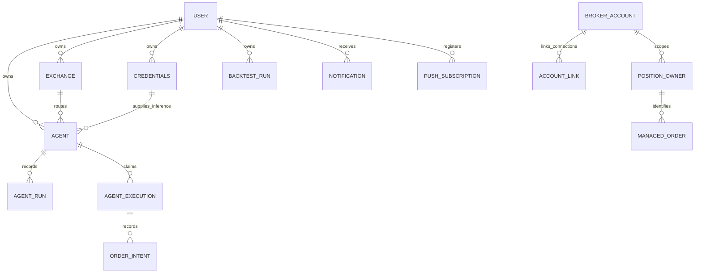

# Persistence and state contracts

[Documentation index](README.md) · [architecture](ARCHITECTURE.md)

MongoDB is the durable source for users, configuration and execution evidence. Redis supplies queues, worker liveness and a rebuildable agent registry. A Redis restart is not permission to discard Mongo execution claims or replay broker submissions.

## Prisma-managed records

Schema: [`meu_frontend/prisma/schema.prisma`](../meu_frontend/prisma/schema.prisma).

| Model | Purpose and identity |
|---|---|
| User, Session, Account, Verification | Better Auth string IDs; mapped lowercase collections. |
| Agent | ObjectId; owner, saved connection/credential IDs, capital/risk/cadence, strategy config, status, next-run and activation timestamps. `Agent.risk` and `Agent.capital` own the policy; a crypto algorithm's `strategyConfig.simulation` is projected from them at write time. See [risk policy ownership](RISK_POLICY_OWNERSHIP.md). |
| Exchange / Credentials | ObjectIds; owner, descriptive names/type, encrypted secrets and provider/account settings. |
| AgentRuns | ObjectId run history; worker also writes additive structured memory/execution fields not all represented in Prisma. |
| BacktestRun | Owner-scoped versioned strategy/config snapshot, contract, candles/data hash, assumptions, results and creation time. |
| Notification / PushSubscription | Owner-scoped inbox and browser endpoints. Delivery job uniqueness is also maintained by the consumer. |
| Trades / Positions / OrderLogs | Existing schema models; do not treat them as the authoritative live execution ledger. Inspect actual writers before extending them. |

Except explicit auth relations, many links are scalar identifiers enforced in application code. The diagram is logical, not a claim of Mongo foreign-key enforcement.

## Native Mongo collections

These are written directly by services and frontend recovery code. Their schemas and indexes are not fully managed by Prisma. Search collection names in the generated [code map](reference/CODE_MAP.md) and source before changing them.

| Collection | Key / contract |
|---|---|
| AgentExecutions | Execution ID; STARTED, COMPLETED or REVIEW_REQUIRED plus outcome, failure and recovery evidence. |
| ExecutionLocks | Unique scope ID: agent, saved exchange, verified Delta account or recovery coordinator. Owner execution ID governs release. Administrative operations also use agent scopes. |
| OrderIntents | Execution/sequence identity; PENDING, CONFIRMED, REFUSED or RECONCILED. Preserve broker/client IDs and requested operation evidence. |
| BrokerAccounts / BrokerAccountLinks | Verified physical Delta account key and connection-to-account mapping. Two saved connections can refer to one physical account. |
| CryptoPositionOwners | Account/product scope; PENDING, OPEN, FLAT or REVIEW_REQUIRED ownership with agent and order references. |
| ManagedCryptoOrders | Account/client-order identity; submission status and broker quantities. SUBMITTING is uncertain until authoritative lookup proves its result. |
| CryptoOwnershipPeriods | Historical ownership identities and start/end timestamps; order references live in ownership/managed-order records. |
| CryptoAccountDailyEquity | Account/day baseline used by account loss guards. |
| AgentDailyRiskUsage | Agent, market timezone and date; durable daily entry/opening reservations. These are not cleared by pause or recovery. |
| PaperTradingState / CryptoStrategyState | Agent-scoped strategy state key, optionally revised state ID. Simulated portfolios and live candle/entry cursors respectively. |

## Lifecycle rules

1. Creating an agent produces PAUSED configuration. First activation defines the strategy signal boundary.
2. A worker persists execution and order-intent evidence before broker effects. An HTTP timeout cannot prove an order was not accepted.
3. A successful safe completion releases owned locks. Ambiguous broker effects retain review evidence and claims.
4. Recovery requires fresh broker evidence and an inactive execution, reconciles terminal flat state, then releases matching locks. It does not erase history, reset risk counters or activate the agent.
5. Intentional live resume warms current indicator history without replaying stale entries; restarting the same activation does not hide missed live candles.
6. Paper configuration revisions preserve older portfolios. Ticker, connection and execution mode are immutable in the algorithm editor.

## Retention and maintenance

Notifications currently have no TTL. Owner-scoped Delete all is a UI operation; it does not imply execution history deletion. Backtest creation caps saved runs at 100 per owner; indicator histories and retained paper trades are bounded separately. There is no general automatic archival policy for execution/ownership evidence.

Do not add TTL to ExecutionLocks, unresolved OrderIntents or ownership records. Safe retention requires terminal-state classification and preservation of the evidence used by recovery. Large histories can reach bounded inspection limits; a paginated/archive workflow remains future work.

Mongo change streams require a replica set. Prisma defaults affect new writes; they do not reliably repair old documents containing explicit nulls. Before making a field required, count missing/null documents and apply a reviewed, idempotent backfill. Keep frontend and worker readers compatible during rollout.

## Sizing policy additions (9 October 2026)

Generic agents optionally persist `strategyConfig.sizing` version 1; absent records retain legacy notional semantics. Algorithm `strategyConfig.simulation` optionally persists `leverageMode` and `maxExposureMultiple`; absent values preserve fixed leverage and the prior exposure ceiling. No required Mongo field or migration is introduced. `OrderIntents` additionally records `delta-leverage` setting operations before automatic broker writes. A pending settings outcome is reconciled from matching isolated/leverage readbacks, separately from managed order identity verification. See [sizing policies](SIZING_POLICIES.md).
