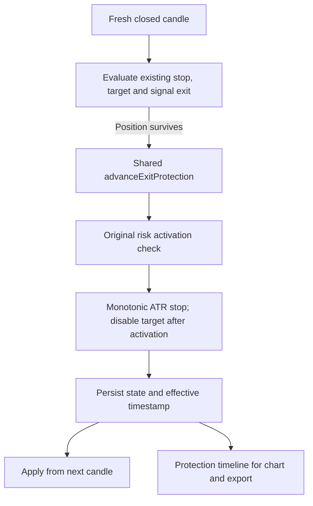

# Exit management

Implementation review: 10 October 2026.

## Current behavior

Live algorithm orders retain their existing native stop and take-profit protection. Adaptive exits are implemented as an **internal opt-in for historical and paper engines**, not enabled for live accounts or shown as another form setting. Existing agents and saved runs are not migrated. Mean reversion keeps its fixed target policy. LLM agents do not gain a protective-order amendment tool in this change.

## Adaptive policy

`SimulationConfig.exitPolicy` accepts version 1, mode `atr-trailing`, an activation in original risk units and an ATR distance. The offline comparison uses activation **1R** and distance **2 ATR**. These are research parameters, not a recommended profitable preset.

1. Size using the initial stop and existing capital, margin, exposure and daily limits.
2. Keep the original stop and target until a completed close moves at least the activation distance in the profitable direction.
3. Check each candle against the protection already in force, including the fixed target. A target hit takes precedence over activation at that candle's close.
4. After activation, remove the fixed target and trail from the completed close by the configured ATR distance. Never widen the stop.
5. Apply each amendment from the next candle. Opposite strategy signals, funding, liquidation and gap handling continue to apply.

For entry 100 and original stop 98, 1R is 2. A close at 102 activates a 1R policy; at ATR 1, a 2 ATR trail proposes stop 100. This is price breakeven, before fees and slippage. A wider ATR may leave the tightened stop below entry. Protection can reduce a loss without guaranteeing a net profit.



## Reproducible comparison

```sh
bun scripts/compare-exit-policies.ts docs/reports/signal-policy-data-2026-10-10.json docs/reports/exit-policy-results-2026-10-10.json
```

The comparison uses original entry rules and identical starting capital, costs, sizing and data. Holding duration can change later entries and account equity, so subsequent trade lists and quantities need not be identical. The retained windows were already examined in earlier research and are not untouched validation. Results include fees, slippage and approximate funding.

| Market window | Strategy | Fixed return | Trailing return | Fixed drawdown | Trailing drawdown |
|---|---|---:|---:|---:|---:|
| BTC audit month | donchian | -1.78% | 0.24% | 2.94% | 2.12% |
| BTC audit month | ema | 1.33% | 1.89% | 3.60% | 3.25% |
| BTCUSD 2026-06-10 | donchian | -4.06% | -5.85% | 5.53% | 7.39% |
| BTCUSD 2026-06-10 | ema | -0.66% | -0.74% | 2.42% | 2.42% |
| BTCUSD 2026-07-10 | donchian | -4.75% | -4.88% | 5.22% | 5.34% |
| BTCUSD 2026-07-10 | ema | -2.92% | -3.73% | 4.38% | 4.56% |
| BTCUSD 2026-08-10 | donchian | -6.44% | -3.28% | 7.93% | 9.19% |
| BTCUSD 2026-08-10 | ema | -0.21% | -0.75% | 3.60% | 3.60% |
| ETHUSD 2026-09-10 | donchian | -3.45% | -0.59% | 5.60% | 5.03% |
| ETHUSD 2026-09-10 | ema | -0.63% | 0.08% | 4.09% | 3.38% |

Trailing improved some windows and worsened others. Most runs remain negative. This evidence does not support replacing the default exit policy or increasing leverage. A sustained rally in a historical chart does not by itself identify an executable profitable entry.

## Persistence and charts

Paper positions persist original stop, current stop, target activation state and protection history. Restart validation rejects malformed positions and incompatible policy changes while a position remains open. Each completed trade records a protection timeline; selected-trade charts draw stop steps from their effective timestamps and end the target when it is disabled. Historical fixed-policy runs retain their original record shape.

## Live amendment work remaining

The live runner explicitly rejects an adaptive policy before broker access. This prevents a research configuration from silently executing with different protection. To support live amendments, implementation still needs:

- Verified linkage between the managed entry and its active protective child, with side, quantity, trigger type and precision checks.
- In-place amendment and authoritative readback; no period without verified protection.
- Durable amendment evidence and recovery for acceptance followed by timeout or restart.
- Wrong/manual child, partial-fill, rejected amendment and uncertain-response fixtures.

Delta's [edit bracket endpoint](https://docs.delta.exchange/#edit-bracket-order) describes entry-order bracket parameters; the existing integration does not establish filled-position child amendment behavior. Installed CCXT `editOrder` uses the ordinary orders endpoint, and unified parsing omits important Delta child fields. Neither an echoed entry bracket nor matching ticker alone proves ownership of the active stop.

## Cleanup decisions

Experimental signal-version and entry-source selectors were removed from normal create/edit/backtest forms. Editing preserves a saved strategy version; new configurations use original signals. The versioned engine branches remain for saved-run reproduction. Existing useful advanced risk settings remain; no new trailing controls, optimization dashboard or test matrix was added to the product. Generated Python bytecode was removed and ignored. The EMA helper and indicator helper remain because runtime code imports them.

## Verification

Tests cover monotonic long/short stops, close-only activation, next-candle effect, target-before-activation ordering, legacy compatibility, paper JSON restart parity, paper/historical exit parity, invalid persisted position fields, and live rejection before broker writes. Chart tests cover effective stop steps and target removal. No real broker orders or agent activations are part of these checks.
