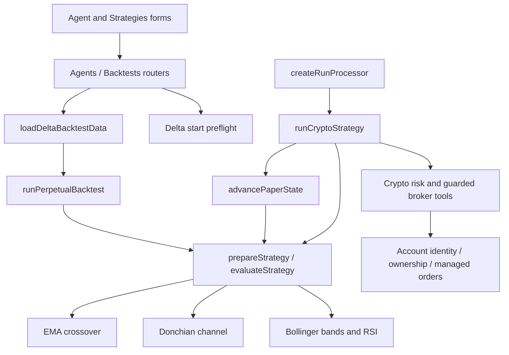

# Modules and change map

[Documentation index](README.md) · [complete function/import index](reference/CODE_MAP.md)

This page describes runtime responsibilities. The generated reference enumerates local imports and named functions with source lines and direct calls. A direct call is syntax evidence, not proof that it executes on every branch. Database, queue and HTTP dependencies need the architecture diagrams as well.

## Main boundaries

| Area | Entry points and collaborators | Responsibility |
|---|---|---|
| Auth and API | `meu_frontend/src/trpc/init.ts`, `src/trpc/routers/_app.ts`, feature `server/router.ts` files | Better Auth session → protected procedure → authenticated owner filters → validation and storage. Never trust an owner ID supplied by a form. |
| Agent lifecycle | agents router, `start-delta-agent.ts`, scheduler `agent/deltaStart.ts` | Create paused, edit with version/lock checks, validate owned references, preflight settings, activate or pause. |
| Scheduling | scheduler `index.ts`, `watchers/watcher.ts`, `schedulers/scheduler.ts`, `queue/queue.ts` | Bootstrap RUNNING records, refresh registry, reconcile durable next-run pointers, enqueue stable jobs. |
| Execution | `workers/worker.ts`, `workers/executionFailure.ts` | Reload authoritative config, claim scopes, dispatch strategy, persist run/failure evidence, notify, release only safely completed claims. |
| LLM strategies | `agent/vercelAgent.ts`, `zerodhaAgent.ts`, `providers.ts`, `runMemory.ts`, prompts and tools | Provider construction, bounded recent compatible context, model/tool loop. Broker tools still pass execution guards. |
| Delta algorithms | `agent/runCryptoStrategy.ts`, `cryptoStrategyConfig.ts`, `cryptoRisk.ts`, `cryptoAccount.ts` | Closed-candle cursor, strategy signals, deterministic sizing, ownership, native protection, live/paper dispatch. |
| Stock strategies | `agent/runKiteEmaStrategy.ts`, `kiteEmaSignals.ts`, `tradeGuard.ts`, Zerodha tools | Legacy Kite EMA/hybrid paths and stock order safety; these are not the Delta perpetual simulator. |
| Shared research | `shared/trading/strategies.ts`, `perpetualBacktest.ts`, `paperTrading.ts`, `delta-data.ts` | Versioned deterministic signals, historical simulation, forward simulated state and trusted market history. |
| Recovery | exchange router, `recover-execution.ts`, scheduler `deltaReconciliation.ts` | Inspect account, verify broker evidence and queue inactivity, reconcile proven terminal flat executions. |
| Notifications | scheduler `lib/notifications.ts`, notificationService `src`, frontend notification routes and push subscription route | Queue producer → idempotent inbox persistence → bounded push delivery → SSE/poll invalidation. |

All scheduler paths in the table are relative to `meu/schedulerService/src`; frontend paths are relative to `meu_frontend`. Use the generated index for exact current exports rather than copying this table into implementation.

## Strategy dependency diagram

Market research charts live in frontend `src/features/charts`: protected `charts` procedures fetch bounded public Yahoo/Delta/Binance data, `types.ts` maps owned agent tickers, and native rendering/indicators stay in browser components. Chart changes never call order or agent-update procedures. See [chart module diagram and data limits](CHARTS.md).

Signal reuse does not imply identical fills: the backtest assumes candle prices and costs; live orders use exchange evidence and native brackets.

## Files to inspect together when making changes

| Change | Inspect together | Verification focus |
|---|---|---|
| New agent field | Prisma schema, form schema/components, create/update router, scheduler config projection, worker prompt/config, docs | Existing records with missing/null fields; UI defaults must not silently replace stored values. |
| New algorithm | shared strategy catalog/validation/evaluation, simulator and paper engine, live dispatcher, strategy editor | Warmup, closed candles, no lookahead, sizing/exit assumptions, saved version compatibility. |
| Risk limit | crypto risk, tradeGuard, dailyRiskUsage, worker/tool context, accountRisk | Shared-account exposure and durable counters; failed/uncertain orders must not erase reservations. |
| Provider/model | providers, credential schema/router, model discovery, LLM context/error normalization | Catalog versus inference access, endpoint/region, credential ownership, tool support. |
| Recovery rule | reconciliation inspector, recover-execution, worker intents/locks, recovery UI | Exact identity, complete quantities, no active worker, concurrent changes, retry after partial persistence. |
| Notification | failure classification, producer payload, notification consumer/schema, frontend route/UI | Durable inbox survives push failure, owner scope, redaction, duplicate delivery. |

## Important shared contracts

- `strategyStateKey` keeps revised portfolios scoped to an agent; changing its format can strand existing state.
- Broker account identity, rather than saved connection ID alone, scopes Delta ownership and account locks.
- Order client IDs connect a submitted broker operation to its durable intent. Missing legacy IDs cannot be invented during recovery.
- An import from frontend into scheduler code brings that file's transitive dependencies into the frontend server build. Keep browser components away from broker/database modules and verify the production build after changing this boundary.
- The in-app Help is user-facing guidance. Root docs explain implementation; update both when behavior changes.

## Sizing and automatic leverage

See [sizing policies](SIZING_POLICIES.md) for shared risk/margin/exposure calculations, fixed versus automatic algorithm leverage, 100% margin, gross-notional percentages and compatibility with saved configurations. Paper/backtest AUTO uses minimum viable leverage within the ceiling; live execution additionally verifies flat-ticker broker settings and durable setting intents.

### Trading-day policy

`shared/trading/marketDay.ts` supplies `exchangeMarketTimezone`, `marketDayIndex`, `marketDayStart` and `marketDate`. Historical/paper simulators consume the saved simulation timezone; Delta schema/worker normalization supplies Asia/Kolkata. Live entry reservation IDs and crypto loss-ledger windows use the same functions. Generic offline simulations default to UTC. See migration and parity (local evidence, excluded from Git).
