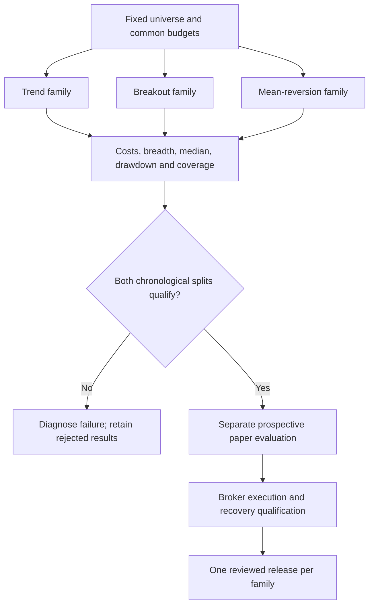

# Research across tickers and algorithm families

Reviewed **13 October 2026**. This is internal crypto strategy research, not a newly deployed strategy catalog. The objective is common rules across tickers and economically useful algorithms in several families. A successful XRP test cannot qualify a release for other markets.

## Evaluation contract

- Keep BTC, ETH, SOL, XRP, ADA, DOGE and LINK in every comparison. Publish losing and inactive accounts; do not select the universe by historical profitability.
- Use the same algorithm parameters, costs and risk budgets across tickers. No separate optimized thresholds for each coin.
- Evaluate trend, breakout and mean reversion separately. A winning trend algorithm does not validate the range algorithm.
- Measure mean **and median** return, profitable-ticker coverage, trade counts, drawdown, paid costs and results excluding the strongest ticker.
- Require positive stressed mean/median and mean excluding the best ticker in both chronological splits, at least six of seven profitable tickers with five or more trades each, worst drawdown at most 20%, and no simulated liquidations. If no candidate passes, record no qualified release.
- Distinguish signal quality from contract affordability. Zero trades do not count as a profitable outcome, and a smaller account cannot necessarily trade every instrument under the same loss budget.

This screen is a declared research decision, not an exchange rule or a guarantee of future returns. Do not relax it after inspecting a near-pass.

## Families under investigation

| Family | Tested mechanisms | Current evidence |
|---|---|---|
| Trend | Volatility-normalized moving-average signals, multiple timescales, separate entry/exit thresholds, wider stops, signal-clock trails and break-even protection | Strongest broad lead; positive full-period results across all seven tickers in a long-only profile, but chronological breadth remains insufficient |
| Breakout | Separate 55-bar entry/20-bar exit channels, volume confirmation, wider stops and trailing; squeeze as a comparison control | Some improvement over legacy event controls, but weak later periods and concentrated profits |
| Mean reversion | RSI recovery/extreme entries with trend context, SMA5/SMA20 targets; Bollinger re-entry with pre-excursion range tests; costs checked before entry | Plain variants lose broadly; economic checks often reject shallow recoveries. No profitable broad release demonstrated |

The trend hypotheses are adaptations of volatility-adjusted moving-average forecasting; [the author's EWMAC example](https://github.com/robcarver17/systematictradingexamples/blob/master/ewmac.py) is a mechanism reference, not a crypto performance claim. Our ATR normalization and thresholds are explicit choices. The range experiments draw on [Alvarez's RSI research](https://alvarezquanttrading.com/blog/rsi2-strategy-double-returns-with-a-simple-rule-change/) and [Jesse's example](https://github.com/jesse-ai/example-strategies/blob/master/RSI2/__init__.py); adding our recovery rules, shorts, stops and cost budgets changes the strategy. [Donchian documentation](https://www.tradingview.com/support/solutions/43000502253-donchian-channels-dc/) explains channels rather than proving an edge.

## Broad trend candidate: exact mechanics

Use completed UTC four-hour bars. Let `A` be Wilder ATR32. The multiscale score is:

```text
fast = (EMA8 - EMA32) / A
slow = (EMA32 - EMA128) / (2 × A)
score = (fast + slow) / 2
```

The slower-scale denominator is fixed before scoring. It prevents the shared EMA32 from cancelling into one scaled EMA8/128 spread. This is a multiscale price signal, not independent information from unrelated sources.

- Generate a fresh long event when the score enters the region at or above 0.5, and a short event at or below −0.5. A neutral state can reset event eligibility.
- Exit a long after score ≤ 0; exit a short after score ≥ 0. Entry and exit thresholds differ to reduce small-crossing churn.
- Initial stop: 2 ATR32 from simulated entry. Quantity fits the configured stop-loss budget, costs, margin, exposure and whole-contract minimums.
- The tested trail ratchets from the highest/lowest since entry by 6 ATR32. Collect hourly extrema; update protection only after a completed four-hour close. The new stop is effective the following hour and never widens.
- No fixed take-profit. Existing initial protection and raw signal exits remain active.
- Long-only and both-direction modes were evaluated for every family/control. Long-only was not selected separately for each ticker.

These trailing mechanics are simulated. Live Delta adaptive exits need separate broker protection/amendment and recovery qualification before implementation. This candidate is not selectable in Meu.

## Results across the fixed universe

November 2024–September 2026, continuous within the full window. Same long-only trend rules and 6 ATR trail, **$1,000 per independent asset account**, 0.5% stop-risk. Stress costs: 20 bps fee and 10 bps slippage per side, adverse 0.03% funding every eight hours.

| Ticker | Net return | Maximum drawdown | Trades |
|---|---:|---:|---:|
| BTC | +3.35% | 4.35% | 30 |
| ETH | +8.12% | 7.19% | 28 |
| SOL | +1.25% | 3.35% | 11 |
| XRP | +32.37% | 19.75% | 39 |
| ADA | +2.17% | 7.10% | 27 |
| DOGE | +10.50% | 6.02% | 26 |
| LINK | +2.55% | 9.81% | 37 |

Mean return is **+8.62%**, median **+3.35%**. Excluding the strongest ticker, the mean remains **+4.66%**. These are whole-window returns, not annual or monthly returns and not the return of one shared $1,000 portfolio.

The earlier chronological window had six positive tickers; SOL had no affordable entry. The later window had five positive tickers; ADA and LINK lost. Later mean/median returns were only +0.31%/+0.23%. **No candidate passed the full qualification screen.** Seven positive full-window results alone do not establish robust performance across regimes.

At 2% stop-risk, the same trail's full-window mean rose to +28.48%, but worst drawdown reached about 48.4%. Higher profits with much larger drawdown are not a free improvement. At $25 and 0.5% stop-risk, only two of seven tickers traded and the universe median was zero. This is a contract-feasibility constraint, not evidence that a zero-trade strategy works.

## Development direction



Do not introduce a market-regime router merely to combine more algorithms: routing into an unprofitable constituent does not fix its economics. First establish useful family behavior, then test causal routing in one account. Keep research variants out of user forms; user-facing setup should stay simple.

The family comparison ran **7,812 simulations**, with **1,638 exact control-ledger reproductions** and **57 passing tests / 66,205 assertions**. These correlated scenarios are not independent samples. All history was inspected during development, so results are retrospective rather than untouched holdout evidence. Hourly OHLC is not a verified passive-fill record; research counters remain UTC rather than Delta live IST, and contract metadata is current. No live agent settings or frozen forward-experiment source changed.

Local evidence, excluded from Git: `docs/reports/MULTI_TICKER_FAMILIES_2026-10-13.md`, `MULTI_TICKER_FAMILIES_2026-10-13.json`, `MULTI_TICKER_FOLLOWUP_2026-10-13.json`, `MULTI_TICKER_RISK_2026-10-13.json`, compressed trade ledgers and `MULTI_TICKER_VERIFICATION_2026-10-13.json`. Local rules and tests are in `scripts/research/families-*`; reproduce and verify with their runners and `families-verify.py`.

Related: [strategy selection](STRATEGY_SELECTION.md), [sizing policies](SIZING_POLICIES.md), [squeeze candidate](SQUEEZE_RESEARCH.md), [execution limitations](EXIT_MANAGEMENT.md), [repository publishing policy](REPOSITORY.md).
