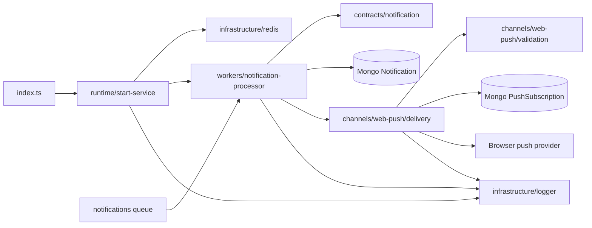

# Project structure and ownership

[Documentation index](README.md) · [Scheduler structure](SCHEDULER_STRUCTURE.md) · [Generated function/import index](reference/CODE_MAP.md)

The application has three process packages and a shared trading library. Each package keeps its own dependencies, tests and container definition. Root Compose and Make files coordinate the complete application.

## Repository boundaries

| Path | Responsibility |
|---|---|
| `meu_frontend/` | Next.js UI, authenticated API procedures, account inspection and user configuration. |
| `meu/schedulerService/` | Scheduling, agent execution, guarded broker operations and execution evidence. |
| `meu/notificationService/` | Notification queue consumption, durable inbox persistence and optional web push. |
| `shared/trading/` | Deterministic rules, sizing, historical simulation and paper trading contracts reused by multiple packages. |
| `docs/` | Maintained architecture, capability and maintenance documentation. |
| `scripts/` | Repository tooling and internal analysis commands; research artifacts stay local and ignored. |

The Next.js route tree, service startup paths and container configuration remain stable. Database collections, API routes, queue names and trading policies are unaffected by folder changes.

## Frontend

Paths below are relative to `meu_frontend/src`.

| Folder | Responsibility |
|---|---|
| `app/` | Next.js route pages, layouts, route handlers and framework loading/error boundaries. Keep route names stable. |
| `features/<feature>/` | Feature-owned components, hooks, validation and server implementation. Existing agents, backtests, charts, credentials, exchange, help, markets, notifications and settings remain here. |
| `features/auth/components/` | Login, signup, auth shell and password input. |
| `features/agents/components/forms/` | Agent create/edit forms, reusable configuration fields, form feedback and entry preview. Agent list/detail views remain in the parent components folder. |
| `features/exchange/server/` | Exchange procedures, CCXT dashboard snapshots, Kite integration, account inspection and recovery. `exchange-data.ts` replaces the misleading generic `lib/config.ts`. |
| `features/notifications/server/` | Inbox procedures, notification event stream and push subscription validation. |
| `features/settings/components/` | UI settings provider and theme/preferences controls. |
| `components/layout/` | Shared workspace header and sidebar. |
| `components/branding/` | Meu logo and brand icons. |
| `components/errors/` | Shared logged React error boundary. |
| `components/entityComponents/` | Reusable entity list, pagination, search, skeleton and state components. |
| `components/ui/` | Shared Radix/shadcn primitives. |
| `lib/auth/` | Better Auth server setup, browser client and request/session helpers. Import the specific module: `server`, `client` or `session`. |
| `lib/logging/` | Application logging, client error reporting/validation and log redaction. |
| `lib/security/` | Credential encryption boundary. |
| `lib/db.ts`, `lib/utils.ts` | Shared database connection and general UI utilities. |
| `trpc/` | API context, router composition and client/server query integration. |
| `generated/` | Prisma-generated code; regenerate through Prisma, never reorganize it manually. |

Folders do not enforce execution boundaries by themselves. Preserve `use client`, `server-only` and existing server imports. Importing the auth client must not pull in server credentials or database code; direct module imports make that boundary visible. The same applies to logging and broker integration.

## Notification service

Paths below are relative to `meu/notificationService/src`.

| Module | Responsibility |
|---|---|
| `index.ts` | Stable executable entry point and fatal startup reporting. |
| `runtime/start-service.ts` | Mongo connection/index setup, BullMQ worker lifecycle, concurrency, worker events and graceful shutdown. |
| `contracts/notification.ts` | Scheduler payload validation, database source mapping and delivery correlation context. |
| `workers/notification-processor.ts` | Validate each job, persist the inbox entry idempotently, then request optional push delivery. |
| `channels/web-push/delivery.ts` | VAPID configuration, bounded subscription fanout, delivery deadlines/retries and expired-subscription cleanup. |
| `channels/web-push/validation.ts` | Trusted push endpoints and encryption-key validation. |
| `infrastructure/redis.ts` | Redis URL/socket connection construction. |
| `infrastructure/logger.ts` | Safe structured logging and error metadata. |

Successful inbox persistence remains independent of optional push delivery. Push retries apply to individual subscriptions, not trading jobs. This separation does not add Telegram, Slack or other channels; future channel implementations can live alongside `channels/web-push/`.

## Maintenance checks

Run the affected package's typecheck and automated tests, build the frontend when server dependencies move, and run `make docs`. Update source paths in curated documentation and test mocks. Do not run ignored manual broker scripts as refactoring checks. Keep experimental research, credentials, generated build output and dependencies outside commits.
