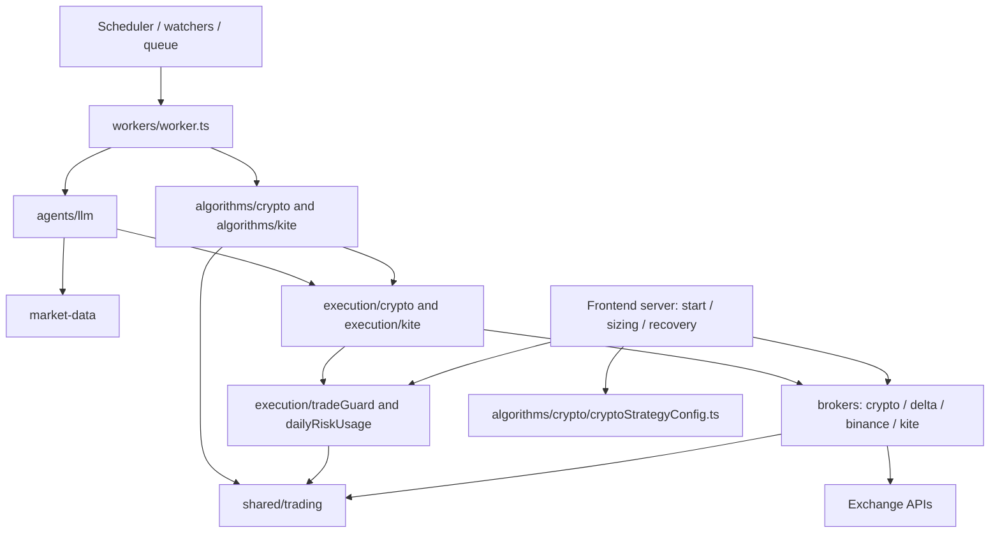

# Scheduler source structure

[Documentation index](README.md) · [Modules and change map](MODULES.md) · [Function and import index](reference/CODE_MAP.md)

Paths below are relative to `meu/schedulerService`. This layout separates orchestration, strategy execution, broker integration and risk enforcement. Moving a module does not change its trading rules, saved strategy versions, database collections, queue names or persisted state keys.

## Folder responsibilities

| Folder | What belongs here |
|---|---|
| `src/agents/llm/` | Crypto and Zerodha model loops, provider construction, recent-run memory and prompts. |
| `src/algorithms/crypto/` | Crypto strategy configuration, closed-candle cursor, live/paper algorithm dispatch. |
| `src/algorithms/kite/` | Kite EMA signal collection and stock algorithm execution. |
| `src/algorithms/emaCrossover.ts` | Stock-facing export of the shared EMA evaluator and types. |
| `src/execution/` | Trading policy, sizing guards and durable daily entry reservations. |
| `src/execution/crypto/`, `src/execution/kite/` | Guarded broker tools used by both LLM and algorithm callers. Tools belong here because algorithms also use them. |
| `src/brokers/crypto/` | CCXT account identity, ownership, risk snapshots, shared-account limits and broker-aware sizing. |
| `src/brokers/delta/` | Delta account preparation, leverage/margin verification and reconciliation inspection. |
| `src/brokers/binance/` | Binance USD-M protected entry and settings integration. |
| `src/brokers/kite/` | Kite token/session management. |
| `src/market-data/` | Crypto/Yahoo analysis, indicator calculations and EMA snapshot helper. |
| `src/workers/` | Job execution lifecycle, failure classification and persistence. |
| `src/schedulers/`, `src/watchers/`, `src/state/`, `src/queue/` | Scheduling, database change observation, runtime registry and BullMQ queues. |
| `src/config/`, `src/db/`, `src/lib/`, `src/server/` | Configuration/encryption, database connection, logging/notifications/Redis and Kite callback server. |
| `tests/` | Isolated software regression tests with broker fixtures/mocks. |
| `../../shared/trading/` | Exchange-independent deterministic strategy rules, sizing, simulations and historical-data contracts shared with the frontend. |

The old `agent/`, `agentFunctions/`, `alogorithmFunctions/` and `strategy/` source folders have been replaced. Imports point directly to their new modules; there are no legacy forwarding files. The main crypto prompt formerly called `testPrompt.ts` is now `agents/llm/prompts/tradingPrompt.ts`.

## Execution and dependency diagram



This is a responsibility diagram. The generated code map lists exact imports, including existing broker/risk interactions; it is not a claim that every layer has only one-way imports.

## Where to make changes

- **Signal or indicator rule:** start in `shared/trading/strategies.ts` and its evaluators. Scheduler `algorithms/` handles execution and state, not a second independent strategy catalog.
- **Algorithm scheduling or missed candles:** inspect `algorithms/crypto/runCryptoStrategy.ts` together with worker, scheduler and persisted strategy state.
- **Prompt, model or memory:** use `agents/llm/`; execution limits still come from authoritative worker configuration and guarded tools.
- **Order, stop, leverage or margin:** inspect guarded tools, the relevant broker folder and `execution/tradeGuard.ts` together. Delta native protection and Binance protected LLM execution do not imply identical algorithm support.
- **Recovery or account lock:** inspect broker reconciliation, worker execution evidence and frontend `features/exchange/server/recover-execution.ts`. Preserve uncertainty checks and managed-order identity.
- **Market context:** use `market-data/`; shared historical simulation remains in `shared/trading/`.

Frontend imports of scheduler modules are server-side dependencies. A move must update those imports, test mocks and production bundle tracing. Avoid exporting broker modules through a broad barrel that might pull private execution dependencies into browser bundles.

## Verification and maintenance

```sh
(cd meu/schedulerService && bun run typecheck && bun run test)
(cd meu_frontend && bunx tsc --noEmit && bun run test)
(cd meu_frontend && bun run build -- --webpack)
make docs
```

The ignored legacy `src/tests/` files are manual broker scripts, not the automated suite; do not run them as cleanup checks. Container entry points remain `index.ts` and `src/workers/worker.ts`. Rebuild images when deploying source changes; moving files on disk does not update existing running containers.
