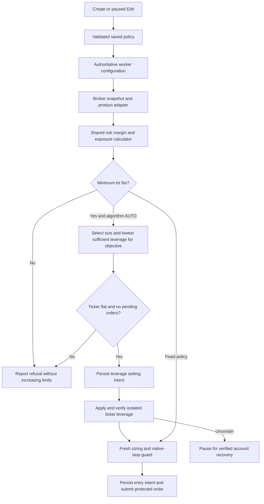

# Position sizing policies

Updated 10 October 2026. Entry limits govern what Meu may request; they cannot guarantee profits, fills or a maximum realized loss.

## What 100% means

| Control | 100% means | It does not mean |
|---|---|---|
| Maximum entry notional | Full allocation can cover gross order value, subject to costs and tighter budgets | Automatically borrowing more funds |
| Maximum margin | Full allocation may be used as collateral after costs | Risking the whole allocation at the stop |
| Maximum gross notional (algorithm) | Gross exposure up to 1× allocation; 200% means 2× | Changing the stop-loss risk allowance |
| Risk at Stop | Estimated loss allowance equal to the allocation | A collateral setting or a guaranteed loss cap |

A $20 allocation with 2% stop risk has a $0.40 estimated loss budget. With a 2% price stop, the theoretical price-only notional is $20, **before** fees/slippage and all other caps. This differs from a legacy full-notional 2% limit, which caps the order itself at $0.40.

## Supported modes

| Runner / adapter | Full-notional policy | Loss at verified native stop | Automatic leverage |
|---|---|---|---|
| Delta India LLM | Yes | Yes, explicit opt-in; one ticker; native attached bracket required | Fixed or automatic within user ceiling |
| Binance USD-M LLM | Yes | Opt-in conditional stops after terminal IOC fills | Fixed or automatic within user ceiling |
| Zerodha stock LLM / EMA / hybrid | Yes, dedicated NSE MIS long entries | Unavailable until verified broker protection is implemented | No leverage credit |
| Delta algorithm, live | Existing stop-risk policy | Yes | Fixed or selected sizing objective within saved ceiling |
| Delta algorithm, paper/backtest | Simulated | Simulated protection | Fixed or selected sizing objective within saved ceiling |

The common calculator and budget types are exchange-independent. Broker adapters supply contract/lot rules, costs, account evidence and protection capabilities. Meu does not grant stop-risk credit merely because a model claims it will close a position later. Binance additionally supports protected native conditional stops. Zerodha supports broker margin previews with full-notional sizing.

## Configuration and compatibility

Generic agent forms save an optional `strategyConfig.sizing` JSON object:

```json
{"version":1,"mode":"STOP_LOSS","leverage":2,"maxMarginPct":100,"maxExposureMultiple":2,"feeBps":10,"slippageBps":5}
```

- Missing policy preserves the historical full-notional behavior. There is no database backfill or reinterpretation of existing live agents.
- `NOTIONAL` credits at most 1× allocation. Its `leverage: 1` describes sizing credit; it does not reset the broker's leverage.
- `STOP_LOSS` uses estimated entry-to-stop loss plus buffered costs. The server, not the LLM, calculates the allowed quantity. Crypto entry amount can be omitted to use that deterministic maximum.
- Fees and slippage are buffers per side; 1 basis point is 0.01%. Crypto uses the larger of configured fee, broker fee and the existing minimum safety allowance.
- Switching a generic form into native-stop mode initializes its trade-risk percentage to at most 2%, avoiding reinterpreting a saved 100% notional allowance as 100% stop-loss risk. Review all settings before saving.
- Generic edits require a paused agent, a version check and an execution edit lock. Native-stop Delta Start uses the existing locked, verified margin/leverage preparation flow.

Algorithm configuration remains in `strategyConfig.simulation`. It additionally supports optional `leverageMode: "FIXED" | "AUTO"` and `maxExposureMultiple`. Missing fields preserve fixed leverage and the prior allocation × leverage exposure ceiling. The form displays gross notional as a percentage: `maxExposureMultiple * 100`.

Every agent card exposes **Edit**, including paper/live algorithms. Live execution edits require a flat ticker, no pending orders and no unresolved ownership, then create a new strategy state revision. Saving does not activate the agent. Paper execution edits require explicit portfolio reset confirmation and retain the previous portfolio. Algorithm stop risk remains capped at 10% by its existing schema; 100% margin is supported separately.

## Calculation

Broker adapters calculate per-unit estimated loss, margin including costs, and gross notional. The shared calculator takes the smallest of:

1. Remaining per-entry and daily loss budgets divided by unit risk.
2. Remaining allocated/account margin and free funds divided by unit margin.
3. Remaining agent/account exposure divided by unit notional.
4. Broker quantity and notional maxima.

It rounds **down**, checks minimum amount/notional and rejects fractional lots or a requested quantity above the result. It never rounds up to one contract by increasing the user's budget. Errors report the limiting budget and minimum order requirements.

Existing positions and pending entries receive conservative collateral/cost loss reserves. They do not receive risk credit from an old model statement or an unverified stop. Shared Delta account limits additionally include manual exposure and other agents. The default account caps are 50% margin, 1% daily loss and 3× exposure; saved account limits can differ. The agent form displays the saved account limits. Raising only margin to 100% leaves the daily loss cap unchanged.

## Automatic algorithm leverage

`AUTO` treats the saved leverage as a **ceiling**, not a target. On a fresh entry signal, Meu tests whole-number leverages from 1× upward using the live quote, rounded native stop, broker contract terms and authoritative budgets. Its optional `autoSizing` objective determines the selection: `MINIMUM_ORDER` (also the legacy default when absent) chooses the first leverage permitting a valid order; `TARGET_RISK` funds the largest permitted rounded position, then chooses the lowest leverage that achieves that quantity. Target quantity is bounded by stop-loss, daily-loss, gross exposure and broker limits; margin and liquidation checks can still fund less than that target. It does not increase the stop-risk percentage, allocated capital, margin ceiling or gross-notional ceiling. It does not tighten an ATR stop to make an order fit.

Changing leverage requires a flat target ticker and no pending orders. Start prepares isolated account mode when safely allowed and preserves verified ticker leverage within the auto ceiling. The entry path changes only the target ticker's leverage; it cannot switch account-wide margin mode. Open positions retain their established leverage and native protection. Other ticker agents continue to share account execution safety.

Before a setting mutation the worker persists an `OrderIntents` operation with `action: "delta-leverage"`, target symbol, chosen leverage and saved ceiling. Readback must verify isolated mode and both sides' leverage before an entry. A known pre-write refusal skips the entry. A lost response or unverified post-write state remains uncertain, sends no entry and retains the execution for recovery.

**Exchanges → account recovery → Verify and recover** supports these setting intents. It requires the same paused, flat, quiescent account checks as order recovery and two matching target-setting readbacks, without broker writes or replaying an entry. Unknown order intents still require managed order identities. A leverage setting outside the intended target must be reviewed on Delta before recovery.

Paper/backtest auto mode uses the common sizing budgets and simplified liquidation-distance rejection. It does not recreate historical account state, exchange margin tiers or real fills. Fixed-mode historical behavior is preserved when optional fields are absent.

## Low-capital settings

For a small Delta allocation, an initial configuration to **evaluate**, rather than a promise of returns, is:

- Explicit loss-at-stop sizing for an LLM, or the algorithm's existing stop-risk sizing.
- 1–2% estimated stop-loss risk per trade, and a separate daily-loss allowance.
- Maximum margin 100% if you deliberately permit full collateral usage. This is permission, not a requirement to consume it.
- One open position and a small daily entry limit.
- A modest fixed leverage, or automatic algorithm leverage with an explicit ceiling; set gross notional consistently with that ceiling.
- Keep cost buffers enabled and inspect account-wide daily-loss headroom.

At public prices read **9 October 2026, 03:27 UTC**, one Delta contract represented approximately:

| Product | Contract value | One-contract notional | Bare margin at 2×, before costs |
|---|---:|---:|---:|
| XRPUSD | 1 XRP | $1.39 | $0.70 |
| SOLUSD | 1 SOL | $110.26 | $55.13 |
| BTCUSD | 0.001 BTC | $82.18 | $41.09 |
| ETHUSD | 0.01 ETH | $24.88 | $12.44 |

These are snapshots, not current trading quotes or recommendations to buy. Minimum contract **loss at the chosen stop** must also fit. More leverage reduces initial margin; it cannot reduce price loss or fees on one contract. If the minimum cannot fit a reasonable loss allowance, use a smaller contract or increase the allocation rather than assuming automatic leverage will solve it.

Sources: [Delta margin reservation](https://www.delta.exchange/support/solutions?articleId=80001177915), [Delta isolated margin](https://www.delta.exchange/support/solutions?articleId=80001199736), [official product API](https://docs.delta.exchange/), [Kite order and cover-order lifecycle](https://kite.trade/docs/connect/v3/orders/).

## Source and execution flow



| Source | Responsibility |
|---|---|
| `shared/trading/sizing.ts` | Pure budget calculation, rounding checks, automatic simulation sizing |
| `shared/trading/perpetualBacktest.ts`, `paperTrading.ts` | Historical and forward simulation consumers |
| `schedulerService/src/agent/tradeGuard.ts` | Policy type, LLM policy text and conservative stock guard |
| `schedulerService/src/agent/cryptoRisk.ts` | Broker snapshots, contract limits and protected crypto sizing/what-if leverage |
| `schedulerService/src/agent/runCryptoStrategy.ts`, `deltaStart.ts` | Flat-ticker setting preparation and deterministic execution |
| `schedulerService/src/workers/worker.ts` | Saved-policy loading, durable intents, serial broker operations and locks |
| `meu_frontend/src/features/agents/validation.ts` | Generic policy input validation |
| `meu_frontend/src/features/backtests/validation.ts` | Algorithm and simulation policy validation |
| `meu_frontend/src/features/exchange/server/recover-execution.ts` | Read-only broker verification before recovering settings/order intents |

Verification uses offline broker fixtures for sizing, protected order acknowledgement, below-minimum refusals, automatic leverage, uncertainty and recovery; it does not place real test orders. Live broker/API failures can still require review.


## LLM leverage control

Delta native-stop LLM agents may save `sizing.leverageMode: "AUTO"`; the saved `leverage` becomes a ceiling. Missing mode preserves fixed leverage. In Create/Edit → Position sizing policy, select **Loss at native stop · Delta India**, then **Meu chooses within my ceiling** and set maximum leverage, margin and exposure independently. Full-notional sizing has no leverage credit and cannot use the leverage mutation tool.

The LLM can call `setLeverage({symbol, side, stop_loss})` before an entry. This tool calculates leverage for the saved automatic sizing objective from fresh quotes, rounded stop prices, broker minimums and account budgets; it does not accept an unrestricted model-chosen leverage. The target ticker must be flat and have no pending orders. Account-wide margin mode cannot be changed by this tool. Settings are persisted as execution intents and read back from Delta. An uncertain write retains locks for the existing account recovery flow. Entry sizing then reads the actual verified leverage within the saved ceiling; it never interprets the ceiling as leverage already applied. No risk limit is raised to make a trade fit.


## Binance USD-M and broker capabilities

The same native-stop sizing fields are available for production Binance USD-M LLM agents, using USDT wallet units. All live Binance runners now verify account identity through Binance account-info UID (read permission required), hashed before persistence and shared across saved connections. Start prepares isolated ticker margin and fixed/automatic leverage; one-way, single-asset mode is required. Authenticated base leverage/maintenance tiers cap sizing. Algorithm/backtest execution is still Delta-specific.

Binance has no atomic attached bracket in this adapter. Protected entries therefore use a price-bounded IOC LIMIT. Meu verifies terminal fills (including no-fill or partial-fill outcomes), journals separate conditional STOP_MARKET and optional TAKE_PROFIT_MARKET close-position operations, and verifies mark-price trigger settings. There is a network interval between the fill and protective acknowledgement. If protection fails, a journalled reduce-only emergency exit is attempted for a matching bounded remaining position. This may also fail; the worker retains uncertain execution locks and reports the protection failure for broker recovery. No retry creates another entry.

A protected Binance agent cannot add to a non-flat ticker. After an exit, unused sibling protection must be cancelled while flat before a new entry. The LLM can cancel its managed protection only once no position remains; it cannot remove an open position's protective stop. Conditional algo IDs are tracked separately from triggered exchange order IDs; reconciliation reads the actual executed order for fill evidence. Recovery requires the same paused, flat account, known order identities and repeated snapshot checks as Delta. Manual changes and missing broker history remain blocked for review.

Zerodha exposes `previewOrderMargin` and verifies Kite `orderMargins` immediately before an entry, checking required collateral and charges against the saved allocation allowance and available funds. The broker determines MIS leverage by instrument and current margin rules; there is no arbitrary `setLeverage` API. Full-notional risk accounting remains in effect. Native-stop risk credit for stocks and NFO strategies are not implemented. Bybit, Kraken and KuCoin have capability-aware explanations but remain unavailable for protected live entries until their order, loss, ownership and recovery adapters are implemented; a CCXT method flag alone is insufficient.

Percentage inputs use 0.01 steps with maximum 100 where applicable. Invalid sizing values suppress the budget preview and fail both form and server validation.


## Automatic sizing objective and compatibility

Native-stop LLM policies store optional `sizing.autoSizing`; algorithms store optional `simulation.autoSizing`. Allowed values are `TARGET_RISK` and `MINIMUM_ORDER`, only with `leverageMode: "AUTO"`. New form configurations use **Fund the permitted position size**. Existing saved configurations without this field keep the first-tradable-leverage calculation until explicitly changed. There is no database backfill, agent activation or budget increase.

**Use the first tradable leverage** does not always order exactly one contract: it sizes within the budgets at the first leverage that permits a valid quantity. **Fund the permitted position size** compares all valid leverages within the ceiling, selects the largest affordable rounded quantity and breaks ties toward lower leverage. It can increase both gains and losses compared with the old objective, while preserving the same saved ceilings. Diagnostics report target contracts, funded contracts, target funding and the binding budget. Paper/backtest trades record these diagnostics only when an objective is explicitly saved.

New configurations share planning buffers of **10 bps fee and 5 bps slippage per side**. Saved custom values remain unchanged. Live crypto still uses the greater of its configured fee, broker fee and existing 10 bps fee floor. These are conservative planning assumptions, not exact GST, funding or realized fill accounting.

## Read-only entry scenario

Open a paused supported live agent's details → **Fresh entry sizing preview**. Choose a saved ticker, direction and hypothetical stop distance, then calculate. Delta live algorithms and Delta/Binance native-stop LLM agents are supported. Paper agents never open broker credentials for this preview.

The preview reads the owned physical account, saved account limits, broker wallet, positions, orders, fees, product metadata, leverage and daily usage. It refuses unresolved locks/submissions, non-flat target tickers and conflicting live owners. Target isolated margin/leverage may be hypothetical; assumptions are labelled and no settings are applied. Delta uses passive bid/ask entry prices; Binance uses marketable ask/bid IOC entry prices. Quotes must be valid and recent when timestamps are supplied.

It deliberately counts all account losses/exposure against the agent as well as account ceilings, so it can be more restrictive than live owner-scoped attribution. It is a scenario, not a current strategy signal, reservation, profitability assessment or activation approval. A saved account/link must already be initialized. If today's equity baseline is absent, the response is **provisional**, assumes current verified wallet equity as day-start equity and performs no initialization. A guarded run establishes the actual daily baseline. Invalid existing baselines refuse calculation.

All transport requests on the separate preview connection are GET-only, at most 32 requests, with a 45-second request-start budget and the connection's 15-second per-request timeout. Owner-scoped database access is read-only. State is checked again before returning; concurrent broker changes can still invalidate the snapshot. Start and every actual entry perform their authoritative checks again.
