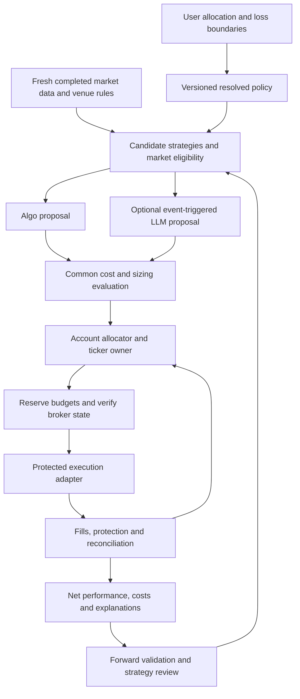

# Small-account automated trading: audit and development plan

Reviewed **10 October 2026** against current source, saved configuration and public exchange documentation. This document records the audit and staged development plan. The progress section distinguishes implemented changes from remaining proposals; it is not an instruction to activate live agents. Three focused audits covered strategies, LLM execution and beginner configuration. No broker writes, agent edits or status changes were made during this review.

## Product objective

Meu should seek the best validated return after trading and AI costs within a user-approved loss budget. Capital efficiency means selecting a useful position size and funding it with the minimum necessary leverage. Using all collateral or the maximum leverage is not itself evidence of a better trade. A losing strategy loses faster when its position size increases.

There is no universally profitable algorithm or universal minimum allocation. A small account is viable only when minimum order size, the strategy's justified stop, costs and account headroom fit together. The system should explain that calculation and find eligible markets instead of asking a beginner to increase risk until an order passes.

The desired experience is: connect an account, allocate funds, choose an acceptable loss and trading style, review a calculated plan, then monitor understandable outcomes. Detailed controls remain available for experienced users.

## Current saved agents

This is a database configuration snapshot, not a fresh broker balance or executable quote.

| Setting | Shadow2 test: LLM | BTCUSD agent: algorithm |
|---|---|---|
| Status | Paused | Paused |
| Market | BTCUSD | BTCUSD |
| Allocation | $25 | $25 |
| Estimated loss at stop per entry | 5% / $1.25 | 5% / $1.25 |
| Daily loss allowance | 10% / $2.50 | 10% / $2.50 |
| Margin ceiling | 40% / $10 | 40% / $10 |
| Gross exposure ceiling | 4× / $100 | 4× / $100 |
| Automatic leverage ceiling | 10× | 10× |
| Entry limit | 3/day | 3/day |
| Scheduled review | Every 5 minutes | Every 15 minutes |
| Decision style | LLM with tool access | Donchian 20; 15m; ATR 14; stop 2× ATR; target 2R |
| Entry confirmation | Model decision | Legacy immediate: no saved entryTiming |

The account's saved ceilings are 100% margin, 10% daily loss, 8× exposure and three open tickers. These settings already permit substantial risk; increasing them is not the first action proposed here. A stop is an estimated loss bound, not a guaranteed fill price.

Both agents target the same BTC position on the same account. Current ownership checks correctly prevent them operating independent live positions there. Nominal allocations total $50, but are not segregated wallet balances. The product must show wallet-backed aggregate allocation and ticker conflicts before activation. For a very small account, one execution owner choosing among signals is more coherent than several competing agents each assuming they own the capital.

## Findings that determine implementation order

| Priority | Verified finding | Consequence | Source |
|---|---|---|---|
| P0 | Crypto LLM dispatch always requests 1m analysis | Review cadence and analysis horizon are disconnected | `meu/schedulerService/src/workers/worker.ts` |
| P0 | Intraday fetch starts 24h ago with limit 500, no pagination/freshness/closed-bar check | Depending on venue response semantics, analysis can use truncated or stale history and an unfinished candle | `meu/schedulerService/src/market-data/cryptoAnalysis.ts` |
| P0 | OHLCV arrays interpolate without row structure; flat-price RSI becomes 100 | Model context and indicators can be misleading | `vercelAgent.ts`, `market-data/indicators.ts` |
| P0 | Opening Advanced changes whether daily loss is derived or taken from a default field | At 5% risk, merely opening the panel can change daily allowance from 15% to 3% | `meu_frontend/src/features/backtests/components/backtest-workspace.tsx` |
| P0 | Backtests default to fee/slippage 5/2 bps, agent creation 10/5, live fee floor 10 bps | A selected historical result may not reflect executable economics | Backtest workspace, `createAgent.tsx`, `cryptoRisk.ts` |
| P1 | AUTO returns the first leverage permitting any minimum order | Approved risk and exposure can remain underused even when a larger bounded order is fundable | `shared/trading/sizing.ts`, `cryptoRisk.ts` |
| P1 | Existing collateral is reserved as potential loss even with protection | One position can consume account daily headroom and block unrelated tickers | `cryptoRisk.ts` |
| P1 | Backtest fills next open; Delta live uses passive post-only limits | Historical entries may never fill live; reversals also differ | `perpetualBacktest.ts`, `cryptoTools.ts`, `runCryptoStrategy.ts` |
| P1 | Cost guidance is LLM prose; model usage is logged in tokens only | A trade may be technically valid yet economically poor; AI cost is absent from net results | `prompts/testPrompt.ts`, `vercelAgent.ts` |
| P2 | No validated strategy selection or portfolio replay | More agents/signals do not establish higher returns | Shared strategies/backtest engine |

The execution safeguards are useful: server-side sizing, native Delta brackets, Binance conditional protection, durable order intents, daily counters, ownership and reconciliation. Preserve these while improving decision quality and explaining restrictions. Software tests establish behaviour; they do not establish trading profitability.

## 1. Correct data, configuration and cost accounting

Introduce an explicit analysis timeframe independent of review cadence. Fetch enough recent completed candles for every indicator, verify ordering, continuity and freshness, and include a clear `asOf` time. Represent OHLCV as structured timestamped records and indicators as named values with unavailable states. Fix flat-market RSI to 50. Use a shared tested calculation where the two agent paths require the same indicator.

Supply the LLM current time, last successful review, next scheduled review, run count, analysis timeframes, data timestamps, policy and current broker facts. Its memory remains historical context, not proof of positions or an ability to predict better over time. Replace contradictory post-only/IOC instructions with the adapter's actual capabilities.

Keep effective form values independent of whether a section is open. Use explicit automatic/manual ownership for derived settings and show changed values when switching modes. Version the resolved settings and cost assumptions used by backtest, paper and live preview.

Costs should distinguish maker/taker fees, fee taxes, spread/slippage, funding, and AI expenses. Delta states that fees apply to notional and 18% GST applies to trading fees; advertised discounts must not be assumed without verified applicability. [Delta fee schedule](https://www.delta.exchange/fees). Account-specific rates and actual fill fees take precedence over a generic estimate. Live safety buffers should remain distinct from expected accounting costs.

**Acceptance:** changing panel visibility does not change submitted settings; identical resolved settings produce identical previews; stale/forming/insufficient histories have explicit outcomes; flat RSI is neutral; a cost breakdown reconciles to saved fills and clearly labels estimates.

## 2. Size the intended position, then choose leverage

Replace the current “first leverage supporting any order” objective with a versioned, explicit **fund the approved target size** policy:

1. Establish entry and a justified invalidation/stop level from the strategy.
2. Calculate target quantity from the chosen per-entry loss budget, remaining daily/account loss budget and round-trip costs.
3. Bound the quantity by gross exposure, liquidity, broker rules and portfolio constraints; round down to valid lots.
4. Find the lowest allowed leverage that funds this target within available collateral and a conservative liquidation buffer.
5. If no candidate funds the target, find the largest feasible smaller quantity and explain which limit reduced it. Never move the stop closer solely to force a minimum lot to fit.
6. Recheck current account and quotes immediately before submission.

Do not change the meaning of existing AUTO configurations silently. Introduce a policy version or explicit utilization objective, show the projected difference, and require a paused edit for live configurations.

**Verified synthetic example, not a market quote:** $25 allocation, $1.25 loss budget, $10 margin allowance, $100 exposure ceiling, up to 10× leverage; a fictional $1-notional contract with a 2% stop and modeled costs. Current AUTO selects 9 contracts at 1×: $9 notional, $9.027 reserved margin, $0.207 estimated stop loss. The same supplied budgets can fund 54 contracts at 6×: $54 notional, $9.162 margin, $1.242 stop loss, assuming the stated simplified liquidation check. That improves budget utilization, but multiplies the loss as well as the gain if the strategy is wrong.

For every setup calculate an approximate minimum allocation:

`max(minimum-lot loss including costs / risk fraction, minimum-lot margin / margin fraction, minimum-lot notional / exposure multiple)`

Then apply actual free funds and shared account headroom. This is a setup-specific lower bound, not a recommended deposit amount. Delta exposes contract terms and commission metadata; Binance publishes quantity, step and notional filters. Read these dynamically instead of hardcoding a token's minimum. [Delta product API](https://docs.delta.exchange/), [Binance exchange information](https://developers.binance.com/docs/derivatives/usds-margined-futures/market-data/rest-api/Exchange-Information).

**Acceptance:** target quantity is independent of arbitrary search order; minimum sufficient leverage is chosen; no candidate breaches any cap; partial utilization and minimum-capital failures are explained; backtest/paper/live previews agree under identical assumptions.

## 3. Establish comparable, credible strategy evidence

Current strategies should be treated as hypotheses to evaluate:

| Strategy | Intended market behaviour | Improvement to test | Principal failure mode |
|---|---|---|---|
| EMA crossover | Sustained directional trends | Trend slope relative to ATR; follow-through or pullback entry; compare fixed target versus trailing exit | Sideways whipsaws and late entries |
| Donchian breakout | Price leaving a prior range | New-breakout episode tracking, expansion/follow-through, optional retest and time expiry | Repeated breakouts and false moves |
| Bollinger + RSI | Reversion within a range | Range suitability, spread relative to expected move, explicit mean exit versus fixed target | Trading against persistent trends |
| LLM | Contextual research and structured proposals | Fresh multi-timeframe evidence, bounded tools, measurable trade economics | Uncalibrated confidence, inconsistent decisions and API cost |
| Crypto hybrid, proposed | Deterministic candidate with selective contextual review | Invoke LLM on a fresh qualified setup or meaningful position event | Added complexity/cost without measurable benefit |

Do not stack every filter onto every strategy. Begin with a small declared set of variants and measure the effect of each. Use market regime as a scored preference initially, with hard rejection reserved for data, cost and risk failures. A high target price alone is not evidence that the market is likely to reach it. Avoid treating an LLM's asserted confidence as a probability for sizing.

Recent same-data checks already showed mixed outcomes: confirmation improved the saved EMA run's return but worsened a mean-reversion run; retests increased trade count in a Donchian run. None establishes a profitable configuration. These observations guide experiments, not parameter selection on that same month.

Improve the simulator before tuning: pre-period warmup, explicit maker/taker execution assumptions, limit fill eligibility and expiry, consistent reversal rules, historical funding when available, shorter-candle treatment of ambiguous stop/target events, and consistent fixed-allocation versus compounding policies. Mark approximations and missing data. An OHLC candle touching a passive order does not prove a queue fill.

Use chronological research, validation and untouched test periods spanning rising, falling, ranging and volatile markets. Record every attempted variant, compare nearby parameters, stress higher costs and delayed/missed fills, and report uncertainty when samples are small. Repeatedly selecting the highest backtest return can overfit; the research on probability of backtest overfitting supports tracking selection bias. [Bailey et al., The Probability of Backtest Overfitting](https://www.davidhbailey.com/dhbpapers/backtest-prob.pdf).

Promote a strategy only under declared criteria: positive net expectancy in adequate unseen samples, tolerable drawdown under the chosen budget, stability across relevant periods, and satisfactory forward paper fills/costs. If evidence is insufficient, show “experimental” or “insufficient evidence.” Do not automatically promote the least-negative result. Historical LLM replay can also leak future information through model training or retrieved news; prospective paper evaluation is essential.

## 4. Make opportunities economically worthwhile

A common proposal format for both agent types should contain symbol, side, entry policy, stop, target/exit rule, horizon, evidence timestamps, invalidation and expiry. Server calculations add quantity, margin, notional, liquidation buffer, break-even move, estimated net target gain, estimated loss at stop, net reward/risk and cost share.

Reject non-positive planned net target gains and unsupported protection. Additional cost/quality thresholds should be validated and versioned, not arbitrary restrictions accumulated until no trades remain. A passing cost test only establishes coherent trade economics; it does not establish positive expected return. Expected return requires credible evidence about outcomes, not only target distance.

Track LLM input/output usage, provider/model tariff provenance and estimated or billed expense per run. Show trading P&L and total net outcome including AI expense separately. For small accounts, use cheap deterministic monitoring between decisions and share a market-data snapshot across agents. Crypto hybrid execution is a future implementation, not currently available. Provider failure must not interrupt exchange-native protection or deterministic reconciliation.

**Acceptance:** no duplicate analysis on the same event; uneconomic proposals explain their costs; provider outages preserve protection; usage costs reconcile to tokens/tariffs; compare pure algo, LLM and hybrid on the same forward opportunities, counting holds and rejected proposals as well as completed trades.

## 5. Coordinate the account as a portfolio

Create a wallet-backed allocation ledger: account equity, reserved cash, allocation promises, actual margin, gross exposure, realized losses and open risk. Respect physical-account identity across duplicate API connections. Entry proposals can be evaluated in parallel; writes and risk reservations must remain race-safe.

Retain one execution owner per ticker initially. Multiple strategies may submit proposals to that owner, which chooses an entry and records attribution. Opposite strategies cannot pretend to own independent positions on a netted account. A later virtual sub-position ledger requires explicit fill attribution and portfolio netting design.

For verified protected positions, investigate reserving loss to the verified stop plus adverse-fill costs instead of always reserving all collateral as daily loss. Define how realized loss, adverse unrealized P&L and remaining stop risk combine without double counting. Revalidate stop coverage, trigger type, quantity and ownership. Missing, changed or unverifiable protection reverts to conservative reserves. Do not assume stops guarantee their prices.

Add correlated exposure limits, account equity drawdown controls and persistent risk reduction after drawdown. Use observed covariance or conservative groups without presenting correlations as constant. A pool of BTC and several crypto longs is not automatically diversified. Recovery should automatically release only demonstrably resolved operations; uncertainty requires broker reconciliation, not deleting locks.

**Acceptance:** simultaneous proposals cannot double-spend budgets; duplicate connections share limits; protected/manual/unprotected positions receive correct reserves; cancellation and partial fills retain ownership; restarts rebuild consistent state; one losing strategy cannot quietly consume every other agent's allocation.

## 6. Beginner setup and daily experience

Start with account, allocation, acceptable loss in currency, trading horizon/style and paper/live choice. Show daily and account drawdown ceilings explicitly for review even if initially derived. Use descriptions such as “reviews hourly” and “holds for hours to days”; avoid names implying guaranteed growth.

Meu calculates eligible markets, indicator warmup, stop distance, valid lots, costs, target quantity, sufficient leverage, margin/exposure ceilings and review scheduling. User-approved ceilings remain binding. Automatic values need provenance and an Advanced override; opening that section must never change behaviour.

Before activation, show one executable readiness card:

> Controls approximately $X using $Y collateral. Estimated loss at the proposed stop is $Z including costs. Selected leverage is L×. Your remaining daily allowance is $D. The current limiting factor is [reason].

If no current signal exists, label the preview as a hypothetical sizing scenario rather than a pending trade. For an ineligible ticker, show minimum required allocation for that scenario and alternative eligible markets ranked by liquidity, costs and contract granularity. A low token price by itself is not a ranking advantage.

During operation show: waiting for setup, waiting for confirmation, order pending, position protected, closing, or recovering. Explain skipped entries in money terms. Reports should separate market losses, fees, funding, AI expense, missed fills and system failures. Backtest trade markers and explanations already provide a starting point.

## Proposed architecture

## Delivery sequence and release gates

| Stage | Deliverable | Required evidence before progressing |
|---|---|---|
| 1 | Data fixes, independent form state, explicit timeframes and unified cost assumptions | Causal/fresh indicator fixtures; form visibility invariance; cost provenance and parity checks |
| 2 | Versioned target-quantity sizing and authoritative readiness preview | Minimum-lot boundaries, account-budget cases, lowest-sufficient-leverage tests and identical preview/replay quantities |
| 3 | Improved fill simulation, economic trade proposals and evaluation reports | Fixed experiment protocol; unseen-period results, sensitivity and uncertainty; no profitability claim from a single month |
| 4 | Portfolio allocation, verified protection risk accounting and event-driven crypto hybrid | Race/restart/reconciliation tests; protection under provider failure; model-cost attribution |
| 5 | Beginner presets backed by evidence and staged forward rollout | Paper/live-preview agreement, observed fill/cost accuracy, clear risk presentation; only then bounded live evaluation within approved limits |

Measure net expectancy, equity drawdown, cost share, fill ratio, rejected-opportunity reasons, actual risk utilization, stability across periods and discrepancy between simulation and observed execution. Track operational failures separately from strategy losses. Avoid optimizing win rate, trade count, return on margin or raw backtest profit alone.

Delta is the first complete deterministic adapter. Binance USD-M already has protected LLM execution with a fill-to-stop network interval; its algorithm/simulation adapter needs separate parity work. Zerodha currently has narrower NSE MIS/full-notional support and broker-determined margins, so it must not inherit crypto leverage assumptions. Each venue should advertise verified capabilities through the same UI contract.

This plan changes the system's decision process and evidence quality before increasing exposure. Existing saved agents and account limits remain unchanged by this audit.

## Implementation progress — 10 October 2026

Stages 1–2 now have an implemented foundation:

- Closed, validated primary LLM candles, structured causally aligned indicators, bounded warmup, explicit timeframe and truthful run timing; primary feed failures use the existing pre-broker retry flow.
- Form disclosure no longer owns daily-loss settings. New configurations share 10/5 bps fee/slippage planning buffers; saved overrides and the live fee floor remain intact.
- Optional explicit target-size automatic leverage is shared by simulation, paper and supported live crypto sizing. Legacy absence keeps its prior objective. Selected size and funding diagnostics are available without increasing saved limits.
- Paused supported live agent details expose a read-only entry scenario with actual account/product/quote reads and labelled hypothetical target settings. Missing daily equity baseline produces a provisional scenario, not an activation approval. The preview conservatively counts all account reserves against the agent and is not exact owner-scoped execution parity.

Offline regressions cover legacy compatibility, minimum lots, margin/exposure/loss constraints, leverage tie-breaking, candle data failures, form validation and preview ownership/no-write behavior. Tests and builds cannot demonstrate real fill parity or profitability. Existing saved agents and account limits were not edited or activated.

Stages 3–5 remain planned: realistic fill/economic evaluation, portfolio allocation and verified-stop risk accounting, event-driven hybrid/AI cost attribution, and evidence-backed beginner presets. No strategy was promoted as profitable by these foundation changes.
