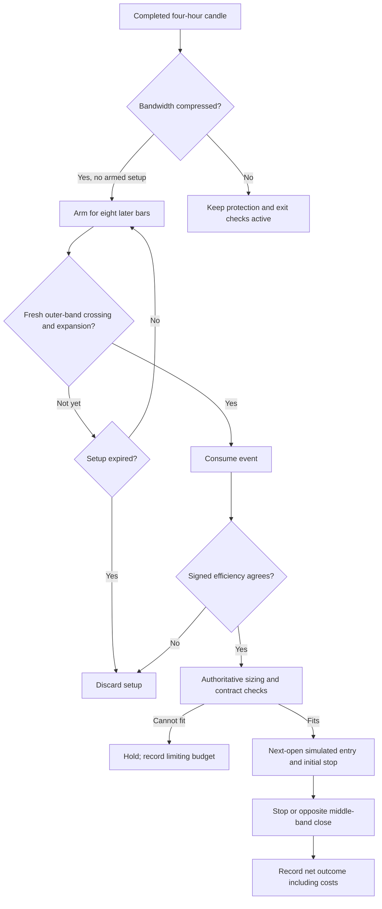
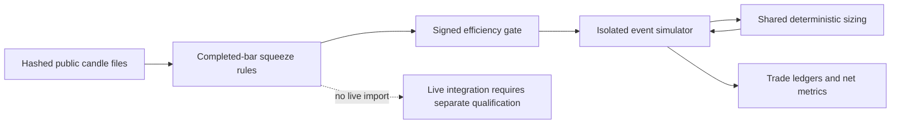

# Four-hour squeeze and directional efficiency

Research specification reviewed **13 October 2026**. This is an internal candidate, not the existing Bollinger + RSI agent and not a selectable live strategy. Its implementation and simulations are local research artifacts, excluded from Git; this specification is maintained documentation.

## Purpose

Find a directional move after volatility contracts, while rejecting breakouts with excessive back-and-forth movement. The intent is to reduce paid churn and hold worthwhile trends. Neither agreement between indicators nor positive historical returns guarantees an edge.

The squeeze concept follows [TradingView's BandWidth explanation](https://www.tradingview.com/support/solutions/43000501972-bollinger-bandwidth-bbw/). John Bollinger distinguishes band touches from trading instructions and cautions against redundant confirmation: [inventor's rules](https://www.bollingerbands.com/bollinger-band-rules). The exact thresholds, timing and execution below are Meu research choices.

## Exact rules

Use completed **UTC four-hour bars**. The replay executes on hourly candles; a signal cannot enter before the following execution-bar open. A still-forming bar supplies no decision.

| Component | Frozen specification |
|---|---|
| Bands | SMA20 of closes ± 2 population standard deviations of the same 20 closes |
| Bandwidth | `(upper − lower) / SMA20` |
| Compression | Current width ≤ 20th percentile of the preceding 120 valid widths, excluding current width; sorted index `floor(0.2 × 119)` |
| Setup | Arm once; do not rearm while armed; expire after eight later four-hour bars |
| Long trigger | A later close crosses above its current upper band; previous close was at/below its previous upper band; bandwidth increases |
| Short trigger | Symmetric crossing below the lower band |
| Efficiency | Signed 20-bar displacement divided by the sum of 20 absolute close changes |
| Long permission | Signed efficiency ≥ 0.35 on the trigger bar |
| Short permission | Signed efficiency ≤ −0.35 on the trigger bar |
| Flat denominator | Reject; efficiency is zero |
| Entry | Next execution open with modeled slippage; one position per independent simulated account |
| Initial stop | 2 × Wilder ATR20 of signal bars, measured from simulated entry |
| Long signal exit | Completed four-hour close below SMA20; execute at next execution open |
| Short signal exit | Completed four-hour close above SMA20 |
| Profit management | No fixed take-profit or trailing stop in this candidate; initial stop and signal exit remain active |

A trigger consumes the setup even when the efficiency gate rejects it. It is not queued until conditions improve. A filled or unfilled order cannot authorize an unrestricted retry. The current research simulator uses events rather than the live proposal lifecycle; live order ownership and recovery would still be required.

### Simple explanation

Imagine price moving in a narrow corridor. The algorithm waits for that corridor to expand and price to break out. It then checks whether recent movement has been mostly in one direction rather than repeatedly reversing. If the event is executable within the account budgets, it enters with an initial stop. A move back through the average ends the trade; a trend can continue without an arbitrary profit cap.

Efficiency describes the path, not the probability of a winning trade. ATR measures movement size, not direction. Waiting for stronger confirmation can also miss profitable early entries.

## Capital and risk are separate

The comparison used 2% stop-risk, AUTO TARGET_RISK, a 10× leverage ceiling, at most 4× allocation in gross exposure, and permission to use up to 100% as collateral. These are ceilings, not a command to spend the full allocation. Daily gross-loss allowance was 10%, with three new entries per day.

Quantity must fit loss at the stop **plus costs**, collateral, gross exposure and whole-contract minimums. Leverage can reduce collateral for a given position; it cannot make an unaffordable stop-loss budget fit. A $25 XRP account can be executable when a $25 BTC account with the same policy is not.

These are independent single-asset simulations, not a shared account with competing agents. Live shared reservations, actual fees, available funds and margin tiers can impose additional constraints. See [sizing policies](SIZING_POLICIES.md).

## Measured evidence and its limits

### Matched 23-month comparison

November 2024–September 2026, 2% stop-risk, stressed costs: 20 bps fees and 10 bps slippage per side, adverse 0.03% funding every eight hours.

| Coin | $25 allocation return | $1,000 allocation return | $1,000 trades |
|---|---:|---:|---:|
| BTC | No trades | +18.31% | 17 |
| ETH | −1.54% | +0.68% | 14 |
| SOL | No trades | −10.36% | 18 |
| XRP | +49.48% | +50.40% | 13 |
| ADA | −8.89% | −9.31% | 16 |
| DOGE | +9.64% | +9.11% | 14 |
| LINK | −2.03% | −1.58% | 13 |

BTC's two separately restarted chronological splits returned +2.69% and +14.60% at $1,000, with 17 trades in total. Positive results from few trades are a research lead, not statistical certification. No-trade accounts are not profitable accounts.

### Longer continuous XRP replay

June 2024–12 October 2026, same policy and stressed costs. Cash and positions carry across months; no adding independently reset returns.

| Initial allocation | Final equity | Net return | Maximum drawdown | Trades |
|---:|---:|---:|---:|---:|
| $25 | $33.84 | +35.36% | 11.08% | 19 |
| $100 | $139.22 | +39.22% | 11.61% | 19 |
| $1,000 | $1,393.26 | +39.33% | 11.74% | 19 |

The separate June–October 2024 XRP window lost about 5.3–5.5%. The later 11-month result becomes negative if its best trade is removed. The full continuous result remains positive after removing its best trade, but 19 observations remain limited and correlated market regimes matter. The seven-asset breadth screen failed. Increasing stop-risk to 5% raised continuous XRP drawdown to roughly 26–27%; it is not a free performance improvement.

All history used to develop these combinations was inspected. Follow-up filters were chosen after seeing earlier results. This is retrospective research, not untouched out-of-sample validation. Fifteen-minute execution checks improved resolution without changing signal timing, but cannot reproduce order-book fills, partial fills or mark-price liquidation. Eight overlapping XRP hourly bars disagreed with aggregated 15-minute OHLC; source differences were recorded rather than repaired. Research counters reset UTC, while Delta live counters use IST.

## Implementation map and reproducibility

The following paths are **local only** in the original workspace. They are absent from a clean clone by publishing policy.

| Local module | Responsibility |
|---|---|
| `scripts/research/combined-rules.ts` | Compression setup, band crossing and closed-timeframe projection |
| `scripts/research/combined-filters.ts` | Directional-efficiency and trend gating without changing exits |
| `scripts/research/engine.ts` | Single-position event replay, protection, costs and accounting |
| `shared/trading/sizing.ts` | Shared deterministic quantity and leverage selection; maintained product module |
| `scripts/research/combined-validation.ts` | Fifteen-minute execution projection of the same hourly policy |
| `scripts/research/combined-continuous.ts` | Continuous XRP account without monthly resets |

Local evidence: `docs/reports/COMBINED_ALGORITHMS_2026-10-13.md`, machine results, compressed ledgers and `COMBINED_VERIFICATION_2026-10-13.json`. Initial work ran 3,144 simulations, with 21 tests and 9,903 assertions; those counts establish reproducible mechanics, not independent profitable samples.

Before promotion: prospective observations, execution/cost/ATR parity, protected order amendments if needed, restart recovery, sufficient observations and acceptable loss limits. Keep experimental selectors out of user forms. [Strategy selection](STRATEGY_SELECTION.md) describes the release process; [repository policy](REPOSITORY.md) explains local research artifacts.

## Later combination tests

A subsequent fixed-rule comparison ran **2,028 additional simulations** and reproduced 312 complete baseline ledgers. At unchanged 2% stop-risk and stressed costs, requiring both trigger volume above its preceding 20-bar mean and a close beyond the prior 20 Donchian channel improved the continuous XRP result:

| XRP candidate | $25 return | $1,000 return | Trades | $1,000 maximum drawdown |
|---|---:|---:|---:|---:|
| Original squeeze + efficiency | +35.36% | +39.33% | 19 | 11.74% |
| Also volume + Donchian confirmation | +42.59% | +48.82% | 13 | 10.90% |

This confirmation did not improve BTC: its matched 23-month $1,000 result was +16.17%, versus +18.31% for the original control. A prior 10 channel exit instead raised BTC’s inspected result to +20.15% but weakened continuous XRP performance. Adding Donchian opportunities freely increased churn and worsened results. Waiting one extra 4h candle with original volume confirmation produced larger XRP returns but only six trades; it is not a better-established release.

These combinations remain local research, not selectable live strategies. All histories were inspected; the broad seven-asset qualification screen still failed. No higher risk or capital was used to manufacture the differences. Local evidence: `docs/reports/ENSEMBLE_STRATEGIES_2026-10-13.md`, its machine results/ledgers and `ENSEMBLE_VERIFICATION_2026-10-13.json`. The research rules live in `scripts/research/ensemble-rules.ts` and `ensemble-confluence.ts`. No production execution or frozen forward-paper source changed.
