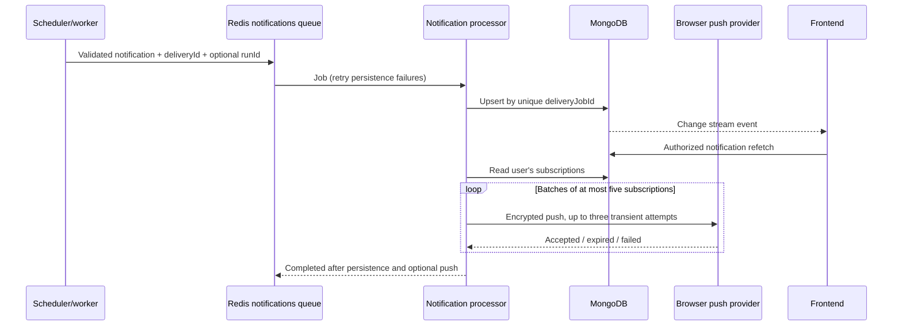

# Notification Service

See [project structure and module ownership](../../docs/PROJECT_STRUCTURE.md) for the current folder layout, dependencies and maintenance boundaries.

Consumes the `notifications` BullMQ queue emitted by `schedulerService`,
persists notifications to the shared MongoDB `Notification` collection, and
delivers them as Web Push to the user's subscribed browsers.

The **database is the integration point**: the frontend watches the
`Notification` collection via a MongoDB change stream (`meu_frontend/src/instrumentation.ts`)
to push live SSE updates into the UI. This service never talks to the frontend directly.

```
schedulerService ──► BullMQ "notifications" queue ──► this service ──► Mongo Notification collection
                                                                     ├─► Web Push (VAPID)
frontend ◄── Mongo change stream ◄───────────────────────────────────┘
```

## Run

```bash
bun install
bun run src/index.ts
```

## Env

See `.env.example`. Notes:

- `MONGODB_URI` / `DATABASE_NAME` must point at the same cluster/db the frontend uses.
- `NEXT_PUBLIC_VAPID_PUBLIC_KEY` + `VAPID_PRIVATE_KEY` must be the **same keypair**
  the frontend serves to browsers (`NEXT_PUBLIC_VAPID_PUBLIC_KEY` in the frontend `.env`),
  otherwise push subscriptions won't validate.
- Generate a new pair with `bunx web-push generate-vapid-keys`.

## Payload contract

Same shape the scheduler emits (validated with zod):

```jsonc
{
  "type": "ERROR",            // ERROR | WARNING | INFO
  "source": "AGENT",          // AGENT | EXCHANGE | SCHEDULER | SYSTEM
  "title": "...",
  "code": "AGENT_EXECUTION_FAILED",
  "message": "...",
  "metadata": "...",          // stringified if not a string
  "userId": "...",
  "agentId": null,
  "exchangeId": null
}
```

Invalid payloads are dropped with a log line (never crash the worker).
Expired push subscriptions (HTTP 404/410) are auto-deleted.

The scheduler supplies an optional UUID `deliveryId`. Persistence uses this ID (or legacy job timestamp/ID) with a unique partial index and an upsert, preventing duplicate notification rows on redelivery. Web Push is not an exactly-once transport.

Subscriptions must use an allowed HTTPS push-service endpoint with valid encryption keys. Transient network/429/5xx failures retry twice per subscription, with a 12-second hard request deadline; final failures are logged. At most five subscriptions are sent concurrently per job. All subscriptions are processed, including older accounts with larger lists. Permanent failures other than expiry are logged without retry. Redis URLs preserve TLS and database selection.

Run `bun run test` and `bun run typecheck` for offline verification. See [container operations](../../docs/CONTAINERS.md) before starting services.

## Function and module map

| Module/function | Dependencies | Responsibility |
|---|---|---|
| `src/index.ts: main` | MongoClient, IORedis, BullMQ Worker | Open Mongo, ensure idempotency index, start queue consumer and graceful shutdown. |
| `redisConnection` | Runtime env, IORedis | Prefer Redis Unix socket; otherwise URL or host/port. |
| `createNotificationProcessor` | Zod schema, Mongo, `sendPush`, logger | Validate event, idempotently persist it, then attempt optional push. |
| `sendPush` | Push subscription collection, endpoint/key validation, web-push encryption, native fetch | Process subscription batches with retries/deadlines and expiry cleanup. |
| `src/channels/web-push/validation.ts` | URL, Buffer | Reject untrusted destinations and malformed browser encryption keys before HTTP. |
| `src/infrastructure/logger.ts` | Pino | Allowlist correlation IDs, fixed events and numeric/error metadata; omit sensitive payloads. |



The frontend additionally polls notification data every 60 seconds and refetches
on focus, so loss of a change-stream/SSE update does not permanently hide alerts.
Provider acceptance is not device receipt. In-app persistence remains successful
when optional push fails. Redelivery deduplicates database rows, but may repeat a
push if a worker dies after sending and before acknowledging the queue job.

## Retention and troubleshooting

There is currently **no TTL index** for notifications. Users can delete all their
notifications through the UI; deletion is scoped to their account. Do not introduce
an automatic TTL without reviewing recovery code that may use older notifications
as legacy execution evidence. Redis completed/failed job retention is distinct
from Mongo notification retention.

If alerts are absent, inspect `notification.queued`, `notification.persisted`,
`push.skipped`/`push.summary` using the same `deliveryId` and `runId`; then check the
Notifications page. Browser permission, matching VAPID keys and a saved subscription
are required for system popups. Never print subscriptions, private keys or payloads
while debugging. See [logging guide](../../docs/LOGGING.md).
