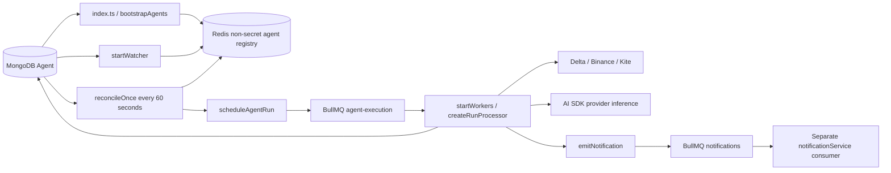
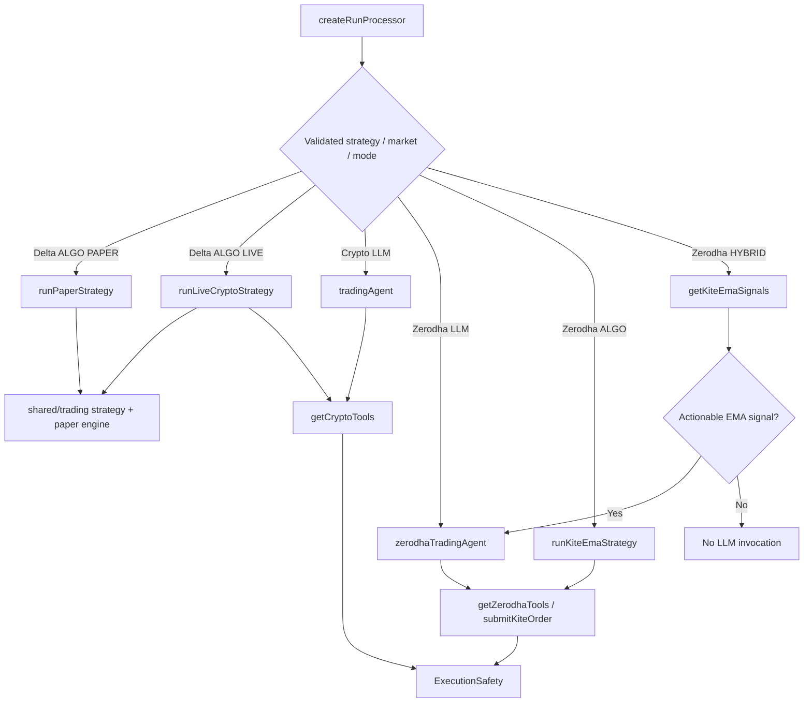

# Scheduler architecture

Reviewed against runtime source on 8 October 2026. [Package guide](../README.md) · [root architecture](../../../docs/ARCHITECTURE.md) · [module map](../../../docs/MODULES.md) · [data model](../../../docs/DATA_MODEL.md).

## Process and module boundaries

`index.ts` starts the agent watcher and scheduler; it does not start execution workers, the notification consumer or background exchange synchronization. Root Compose starts those processes separately. The frontend uses Prisma; scheduler/worker use the native Mongo driver on the same database.

## Durable scheduling

1. Bootstrap loads RUNNING agents. The watcher serializes changes and refetches current Mongo state; reconnect uses bounded exponential backoff.
2. `reconcileOnce` refreshes the full RUNNING registry and removes stale entries, covering missed pause/delete events. Missing schedules are initialized conditionally; existing `Agent.nextRunAt` survives restart and metadata edits.
3. `scheduleAgentRun` creates `agentId-timestamp` jobs with explicit `runAt` and one attempt. The pointer stays on the pending/active job until advanced.
4. The worker verifies the current owner, RUNNING status, exact schedule and resource ownership before using credentials. Obsolete jobs are discarded.
5. Successful completion conditionally advances the pointer and queues the next run. Reconciliation can advance pointers left on terminal jobs. Zerodha closed-market runs schedule the next supported market session.

A restart preserves status and schedules; it does not automatically pause all RUNNING agents. Retained execution claims prevent a broker-uncertain run from being replayed as a new execution. Operational restart choices are documented in [containers](../../../docs/CONTAINERS.md).

## Dispatch and shared dependencies

Delta algorithms support EMA crossover, Donchian breakout and Bollinger + RSI, using saved configuration and production historical candles. Paper execution uses no private credentials or broker calls. Live execution uses authoritative account reads, deterministic contract sizing and broker-managed native brackets. Crypto HYBRID is rejected. Zerodha algorithm/hybrid support is the separate long-only EMA path with restricted NSE MIS LIMIT entries.

Crypto LLM requests `1m` candles; deterministic Delta uses its saved timeframe. Cadence is a separate scheduler setting. See [backtesting](../../../docs/BACKTESTING.md) for simulator assumptions and differences from live fills.

## Claims and broker side effects

Live jobs claim `agent:<agentId>` and `exchange:<connectionId>` locks. Verified Delta accounts also claim `account:<accountKey>`, using broker profile identity through `identifyDeltaAccount`/`registerDeltaAccount`. Multiple saved API keys for one Delta account therefore share safety limits and execution serialization. Paper jobs claim only the agent scope.

`AgentExecutions` uniquely claims a job before strategy execution. Each guarded operation is serialized through `ExecutionSafety.executeOrder`, with a PENDING `OrderIntents` record before the broker request. Explicit refusals become REFUSED; successful operations become CONFIRMED. Unknown results prevent later operations. Status/configuration authorization is rechecked before sensitive effects.

Crypto account ownership uses `CryptoPositionOwners`, `ManagedCryptoOrders` and `CryptoOwnershipPeriods`. Delta evidence checks exact broker/client identity, symbol, side, amount and complete filled + remaining quantities. Missing fields or inconsistent quantities cannot authorize reductions or flatten ownership. Manual positions and foreign entries are not adopted by assumption.

Entry safety combines agent allocation, daily reservations, stop risk, margin, notional exposure and account-wide caps where supported. Daily entry reservations remain consumed for uncertain submissions; pausing/resuming does not erase them. Crypto support and adapter restrictions are in [CRYPTO_TRADING.md](../../../docs/CRYPTO_TRADING.md).

## Failure, pause and recovery

| Condition | Runtime behavior |
| --- | --- |
| Completed execution | Save run/audit, advance schedule and release owned scopes |
| Active account operation | Defer the waiting agent; no takeover or broker order |
| Retained execution lock | Keep other agents waiting with diagnostics and backoff |
| Known temporary pre-order market/provider failure | Persist deferred audit, release safely and retry with backoff |
| Verified typed history/guard/provider rejection before broker operation | Pause affected agent; release scopes after failure audit persistence |
| Uncertain broker result or unverified execution failure | Pause; retain scopes for explicit reconciliation |

Whole-run retry and automatic stalled replay are disabled. Locks do not expire automatically: a timeout cannot prove that the broker rejected a request. The design does not claim exactly-once broker execution over an unreliable network.

Intentional live algorithm Resume changes the activation marker and refreshes bounded indicator history without executing paused-period entry/exit signals. Existing position tracking and daily counters remain intact. Process restart does not change activation; an unexpected missing live backlog still requires review. Partial fills or ownership inconsistencies are not bypassed by Resume.

Frontend recovery (`recoverDeltaExecution`) checks paused linked agents, queue inactivity, exact lock ownership, fresh broker evidence and a flat account with no pending orders. It repairs eligible records, preserves risk counters and releases only the failed execution's scopes, connection last. It supports interrupted repair/release retries when ownership remains provable.

The separate durable `recovery:<agentId>` coordinator is cleaned in ordinary request `finally`. A frontend process crash can leave it orphaned; no safe heartbeat/fencing takeover is implemented. Existing or concurrent coordinators now produce an actionable error. Older reductions without an exact managed order identity also need explicit review. See [recovery runbook](../../../docs/DELTA_RECOVERY.md) and execution audit (local evidence, excluded from Git).

## Run memory and notifications

`AgentRuns` stores successful run text and validated decision memory. Up to five compatible prior runs supply timestamps, model-authored summaries and separate guarded operation receipts. A CONFIRMED operation is not a verified fill. Context fingerprints prevent unrelated configurations from sharing decision history. See [LLM memory](../../../docs/LLM_MEMORY.md).

Worker notices are sent through `emitNotification`. A separate consumer persists Notification records idempotently by delivery job ID before Web Push delivery. The frontend emits SSE invalidations and polls notification queries. Provider push acceptance does not prove display on a user's device. Delivery persistence, push attempts and failure logs have separate semantics; see [logging](../../../docs/LOGGING.md).

Mongo deployment/backups, secrets, exchange access and production rollout are external configuration. Root Compose uses frozen dependency locks and runs all processes; consult [CONTAINERS.md](../../../docs/CONTAINERS.md), including the Podman host-network/Redis socket override when applicable.
